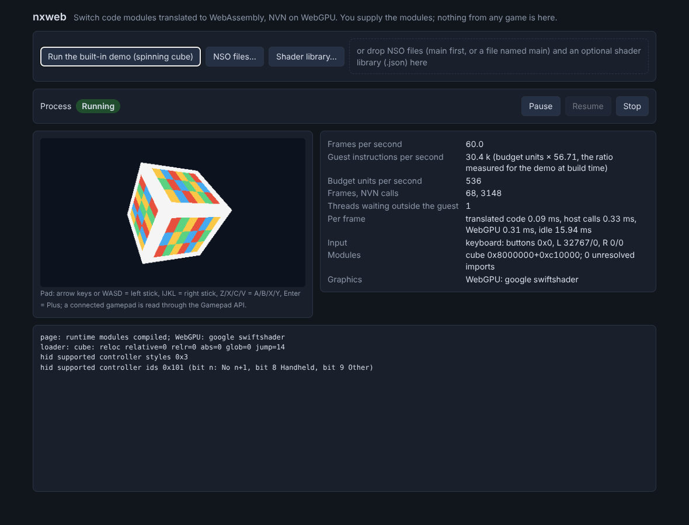

# nxweb

nxnative in the browser: Nintendo Switch game code translated to WebAssembly, with the Horizon host in
AssemblyScript and NVN graphics on WebGPU. A port of [nxnative](https://github.com/seedds/nxnative) (MIT).

You supply your own games. Nothing from any game is in this repository. Not affiliated with Nintendo.

**Status: early.** No game runs yet. Self-made test modules (real NSO files built from C) load, run and draw through NVN in the browser:




| Area | State (from the tests' own summary lines) |
|---|---|
| State machine kit (`src/kit`) | Working: 38 machines, `kit:test` 95 tests, 362 of 362 transitions exercised |
| ARM64 test programs and reference runner (`test/guests`, `tools`) | Working, 21 programs (61 images) |
| ARM64 to WebAssembly translator (`src/a64`) | Working: instruction fuzz clean (338,000 cases), 75 test images pass in four configurations in Node and in Chromium; translation cache; an option that makes guest accesses to host memory trap |
| Module loader (`src/loader`) | Working, 68 tests (no real game file tried) |
| Kernel core (`src/kernel`) | Working, 63 tests |
| Runtime (`src/runtime`, `src/glue/rt_*`) | Working: 39 end-to-end tests under Node, 46 in Chromium: multi-threaded NSO modules, run-time modules (NRO), faults with exact pcs, restart without reload |
| NVN on WebGPU (`src/gfx`) | Working for 333 of 743 NVN functions (14 Node tests, 42 browser scenes); a translated guest draws through it in the page |
| Shaders (`tools/shaders`, `src/shaders`) | Chain works on hand-assembled Maxwell programs, offline and in the page (translated in a Worker, cached); no game shader has been through it |
| File system (`src/fs`) | Working and attached: RomFS images, crash-safe saves on OPFS; 66 tests, 7 in the browser |
| SDK take-overs (`src/hle`) | The names nxnative answers on the host (768 verified, more being added by its owner; `hle:test` 97 tests), attached to the runtime; a guest calls a spread of them |
| Audio (`src/audio`) | In progress, not attached |

How the pieces fit: [docs/ARCHITECTURE.md](docs/ARCHITECTURE.md). What of nxnative is ported, cut or open:
[docs/PORTING-STATUS.md](docs/PORTING-STATUS.md).

Start with [docs/CONTRACT.md](docs/CONTRACT.md). Generated state diagrams are in [docs/machines](docs/machines).

```
npm install
pip install unicorn capstone     # reference emulator, tests only
npm run web                      # the page above, on http://localhost:8080
npm test                         # needs clang with the aarch64 target and ld.lld
npm run rt:browser               # the same and more in headless Chromium (Playwright)
```
