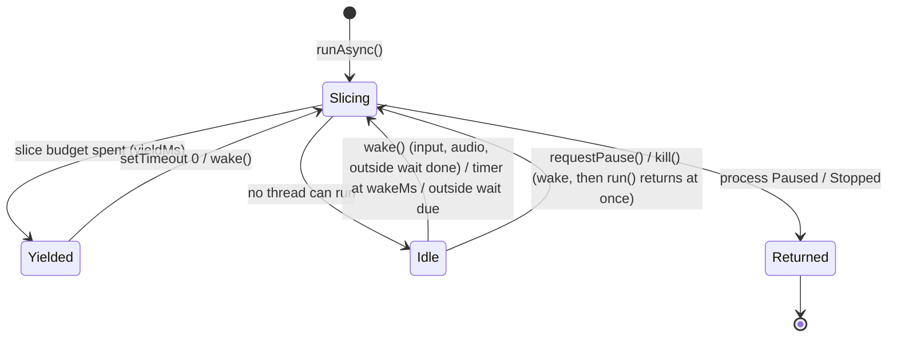
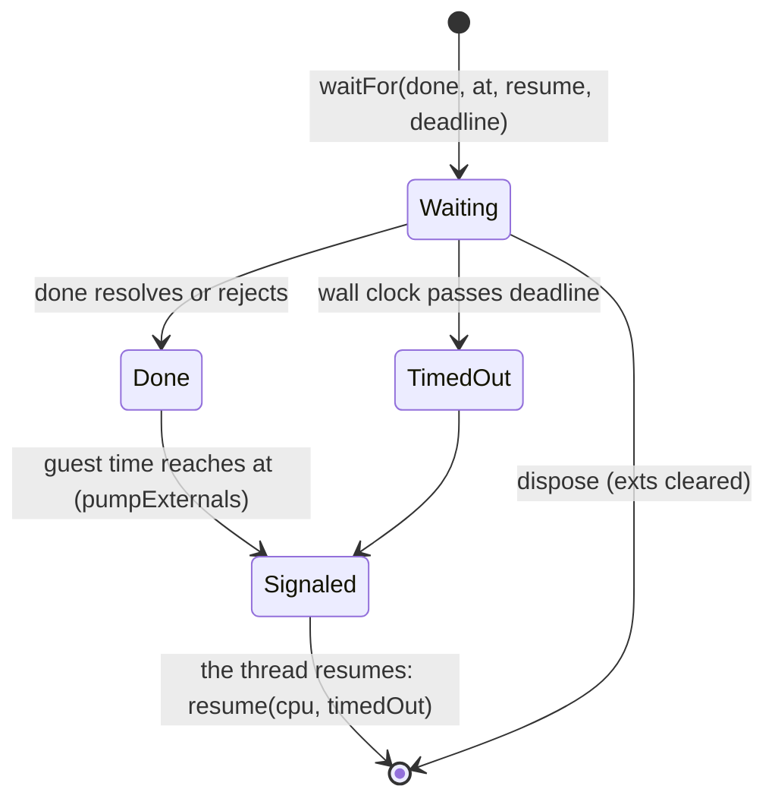
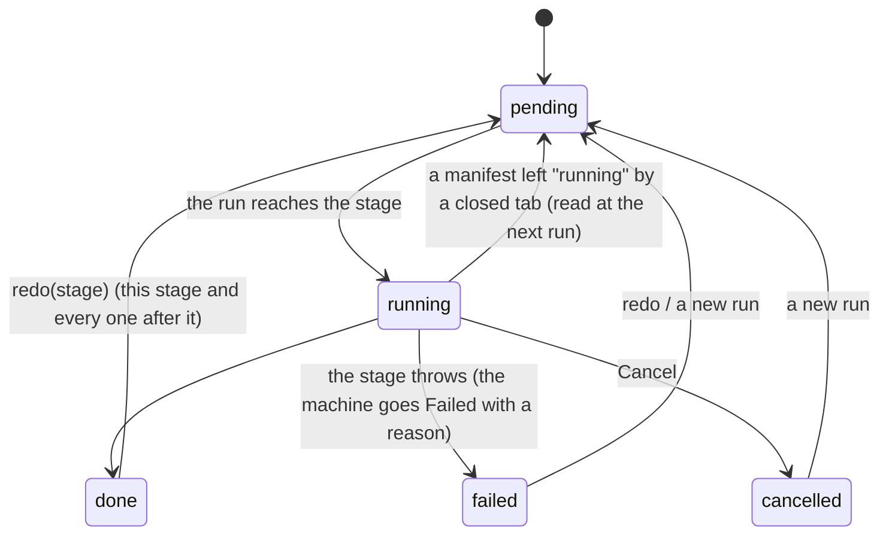
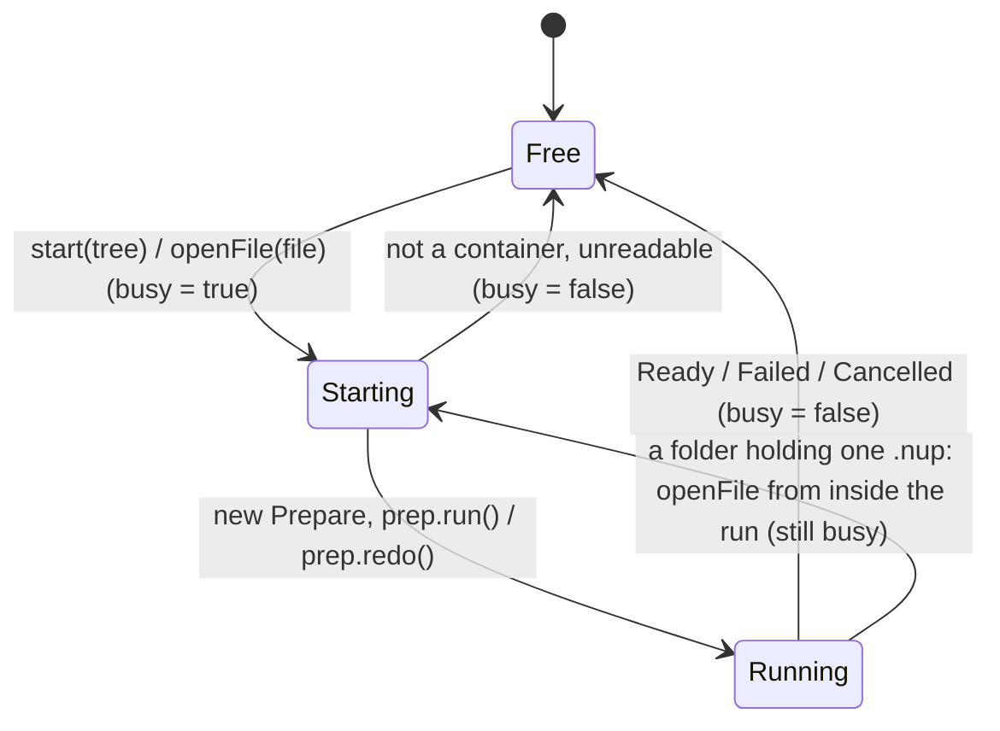
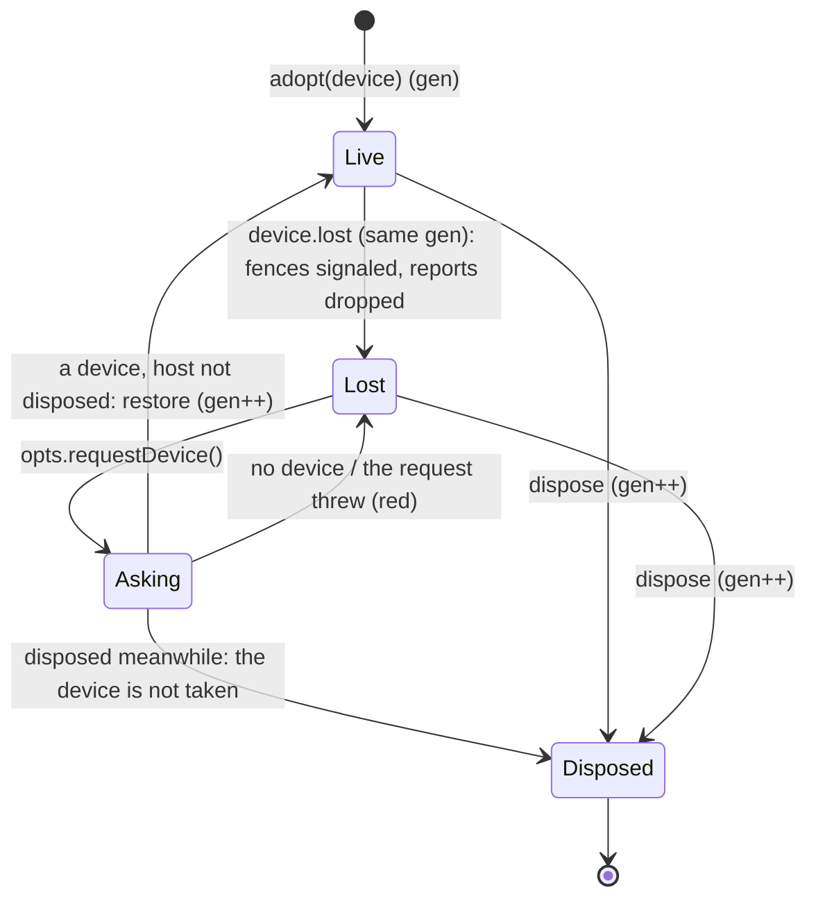
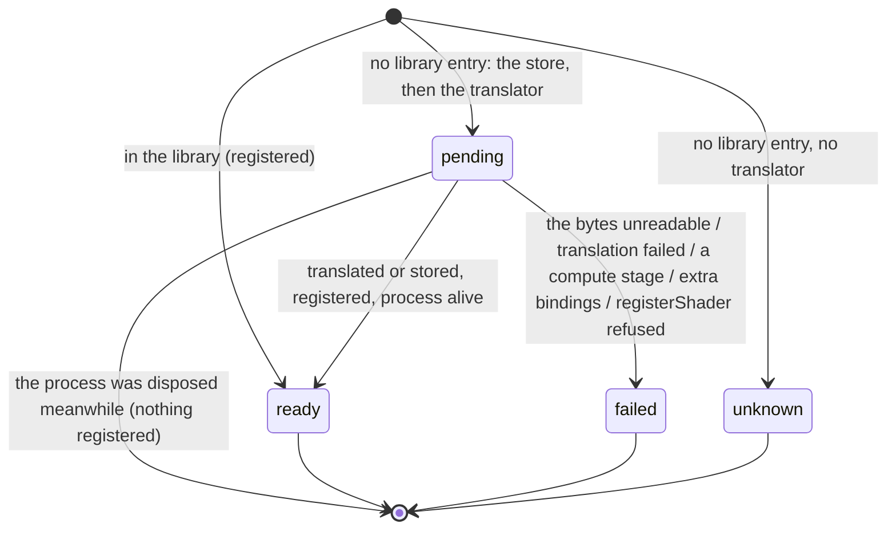

# The implicit state machines

The kit's machines (`src/*/defs/*.json`, drawn in this folder) are the states the wasm modules keep. Around them the
TypeScript glue and the page keep states of their own in flags, unions, maps and promises: the run loop, the
worker's one process, the prepare page, the AudioContext, the GPU device, the shader translations. They are drawn
here by hand from the code (not generated: none of them is a kit table). Each says where it lives, what the kit
machine beside it is, and what was wrong with it.

## The 45 kit machines

| area | machines |
|---|---|
| audio | [audio_buf](audio_buf.md), [audio_out](audio_out.md), [audio_ren](audio_ren.md), [audio_ren_thread](audio_ren_thread.md), [audio_ren_update](audio_ren_update.md), [audio_render](audio_render.md), [opus_req](opus_req.md) |
| fs | [fs_dir](fs_dir.md), [fs_file](fs_file.md), [fs_image](fs_image.md), [fs_mount](fs_mount.md), [fs_pend](fs_pend.md), [fs_save](fs_save.md) |
| gfx | [gfx_cmdbuf](gfx_cmdbuf.md), [gfx_device](gfx_device.md), [gfx_image](gfx_image.md), [gfx_pass](gfx_pass.md), [gfx_pipeline](gfx_pipeline.md), [gfx_render_enable](gfx_render_enable.md), [gfx_shader](gfx_shader.md), [gfx_sync](gfx_sync.md), [gfx_texture](gfx_texture.md) |
| hle | [ctrl_prompt](ctrl_prompt.md), [hle_exit](hle_exit.md), [input_hold](input_hold.md), [jit_env](jit_env.md), [nifm_request](nifm_request.md), [oe_focus](oe_focus.md), [oe_msg](oe_msg.md), [oe_notify_event](oe_notify_event.md), [pad_slot](pad_slot.md), [ro_module](ro_module.md), [six_shake](six_shake.md), [swkbd_inline](swkbd_inline.md), [swkbd_request](swkbd_request.md), [touch_finger](touch_finger.md), [web_session](web_session.md) |
| kernel | [alias_page](alias_page.md), [guest_clock](guest_clock.md), [kthread](kthread.md) |
| kit | [button_latch](button_latch.md), [home_quit](home_quit.md) |
| loader | [module](module.md) |
| prepare | [prepare](prepare.md) |
| runtime | [process](process.md) |

`npm run kit:test` drives all 445 transitions of the 45.

## 1. The run loop (`src/glue/rt_runtime.ts`, `Runtime.runAsync` / `run`)

Beside [process](process.md): `pauseAsked`, `stopFlag`, `wake` (the resolver of the await between slices),
`disposed`, `pending` (threads parked in a host call) and `exts` (outside waits).



`requestPause()` sets `pauseAsked` and wakes; the next `run()` pauses the process between slices. `kill()` stops the
process, disposes and wakes, so an idle loop returns `Stopped` instead of sleeping on.

### One outside wait (`HostCpu.waitFor`, an `Ext`)



A rejected `done` resumes like a resolved one (`timedOut` false): every caller (rt_fs, rt_gfx, rt_audio) reads its own
result after the wait, so the rejection is not lost; this is as documented on `HostCpu.waitFor`.

## 2. The worker's one process (`web/worker.ts`)

`rt`, `running` (a run loop owns `rt`), `runDone`, and the load/stop/resume messages.

```mermaid
stateDiagram-v2
  [*] --> NoProcess
  NoProcess --> Loading: load / handoff / demo
  Loading --> Ending: a process is there (endProcess: cacheSave, kill; await runDone)
  Ending --> Loading
  Loading --> Refused: loadNso refused / 64-bit memory not available
  Refused --> Ending: load / handoff / demo / stop (the refused runtime stays in rt, holding its gfx, audio and saves, until then)
  Loading --> Running: go(me) (running = true)
  Running --> Idle: run loop returned (Paused or Stopped; running = false)
  Idle --> Running: resume (Paused only)
  Idle --> Loading: load / handoff / demo
  Running --> Running: stop (kill: the loop returns Stopped)
```



**Fixed:** `onmessage` was `async` with nothing ordering the messages. Two loads at once (a hand-off and a file
dropped on the page, two clicks on a demo) both ended the old process, then both made a runtime: the first ran on
with its graphics, audio and saves while `rt` pointed at the second, which never ran (`go` saw `running`). The
process messages (`demo`, `load`, `handoff`, `resume`, `stop`) now take turns; input, audio and the report do not
wait behind a load.

## 3. The prepare page (`web/prepare.ts`) and its stages (`src/prepare/host/prepare.ts`)

Beside [prepare](prepare.md): each stage of the manifest is `pending | running | done | failed | cancelled`, and the
page's own `prep` / `busy`.





**Fixed:** the page checked `prep.w.state` and then awaited the prepare module and the scanner before the run
started, so a second click (or a drop during a pick) passed the check too: a second `Prepare` writing the same
OPFS store beside the first (Cancel reached only the second), or `prep.run()` throwing "a run is in progress" into
the internal-error box. `busy` closes the gap; the inner calls (openFile → start, start → openFile) pass through it.

## 4. The AudioContext half (`src/glue/audio_device_main.ts`) and the runtime half (`src/glue/audio_device.ts`)

The device states `NONE 0, STARTING 1, RUNNING 2, FAILED 3, LOST 4` are the runtime's (`src/audio/dev.ts`); the page
half reports them from `ctx`, `node`, `wanted`, `ran`, `suspending` and `serial`.

```mermaid
stateDiagram-v2
  [*] --> Closed
  Closed --> Opening: open (serial++)
  Opening --> Open: worklet loaded, serial unchanged (node connected; "open" with the rate)
  Opening --> Closed: worklet refused ("open" with the error; the context is closed)
  Opening --> Closed: close or a newer open meanwhile (the late context is closed)
  Open --> Starting: start, context suspended (STARTING; resume, after a pending suspend)
  Open --> Running: start, context running (RUNNING)
  Starting --> Running: resume resolved / statechange running / a user gesture
  Starting --> Failed: resume rejected (FAILED)
  Running --> Lost: the browser suspends or interrupts it (LOST)
  Running --> Open: stop (NONE; suspend)
  Starting --> Open: stop
  Open --> Closed: close (the runtime's process ended)
  Running --> Closed: close
```

**Fixed:** when `audioWorklet.addModule` threw, `open` reported the error but kept the context. A `start` after it
resumed that context and reported `RUNNING` for a device with no node: no sound and no red line. The refused
context is now closed and dropped (test/audio/j_main.test.mts).

## 5. The GPU device (`src/glue/gfx_host.ts`)

Beside [gfx_device](gfx_device.md) (Live / Lost): `lost`, `gen` (the device's generation; every async completion of
an older device is dropped) and `disposed`.



**Fixed:** `deviceLost` awaited `requestDevice()` and then called `restore` whatever had happened meanwhile. A
process ended while the browser was asked (the page stopped it, or loaded the next game) had its disposed host
restored: the new device configured on the canvas the next process owns, and `gfx_device_restored` called on a
module that was released (test/gfx/f_device_loss.test.mts).

## 6. One shader key (`src/glue/rt_shaders.ts`, `RtShaders`)

Beside [gfx_shader](gfx_shader.md), which is the recorder's view of the same key.



A key is decided once a process: `failed` and `unknown` are not tried again until the next process.
