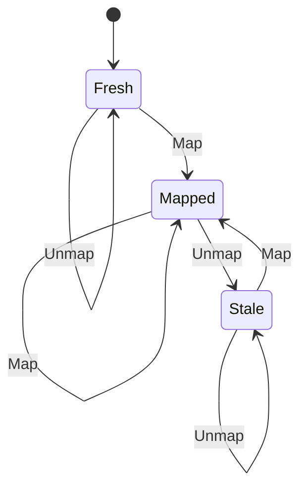

# alias_page

<!-- GENERATED by `npm run kit:diagrams` from src/kit/defs/alias_page.json. Do not edit. -->

One 4 KiB page of the alias region (MapPhysicalMemory / UnmapPhysicalMemory): the single per-page state that replaces nxnative's four bitmaps (mapped, ever exposed, given back, aged). Fresh has never been mapped and reads zero. Stale was mapped and unmapped: its old bytes are still in linear memory, so the next Map zero-fills it first. Mapping a mapped page and unmapping an unmapped one are legal (the SDK does both) and change nothing.

Machine id 33. Any (state, event) pair not listed below is refused: the state stays, `step` returns false and a `[RED] ` line is logged.

| # | State | Carries |
|---|---|---|
| 0 | Fresh (initial) |  |
| 1 | Mapped |  |
| 2 | Stale |  |

| From | Event (#) | To |
|---|---|---|
| Fresh | Map (0) | Mapped |
| Fresh | Unmap (1) | Fresh |
| Mapped | Map (0) | Mapped |
| Mapped | Unmap (1) | Stale |
| Stale | Map (0) | Mapped |
| Stale | Unmap (1) | Stale |
