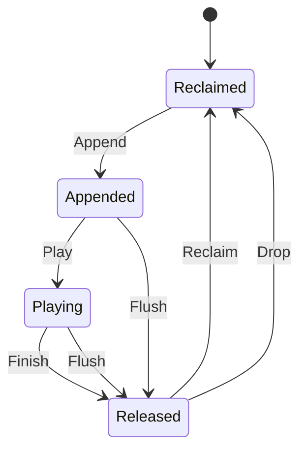

# audio_buf

<!-- GENERATED by `npm run kit:diagrams` from src/kit/defs/audio_buf.json. Do not edit. -->

One buffer slot of an AudioOut (src/audio/out.ts). Reclaimed: the slot holds no buffer (never used, or the game took the buffer back). Appended: queued, not a byte consumed. Playing: the consumer (silent sink or device mixer) is inside it; a change of consumer leaves it here with its position. Released: played to the end, or returned by a Stop or a purge (Flush), and waiting in the released queue for GetReleasedAudioOutBuffer. Drop is a Close with released buffers nobody took. A buffer is released exactly once because Finish and Flush leave Appended and Playing only.

Machine id 2. Any (state, event) pair not listed below is refused: the state stays, `step` returns false and a `[RED] ` line is logged.

| # | State | Carries |
|---|---|---|
| 0 | Reclaimed (initial) |  |
| 1 | Appended |  |
| 2 | Playing |  |
| 3 | Released |  |

| From | Event (#) | To |
|---|---|---|
| Reclaimed | Append (0) | Appended |
| Appended | Play (1) | Playing |
| Playing | Finish (2) | Released |
| Appended | Flush (3) | Released |
| Playing | Flush (3) | Released |
| Released | Reclaim (4) | Reclaimed |
| Released | Drop (5) | Reclaimed |
