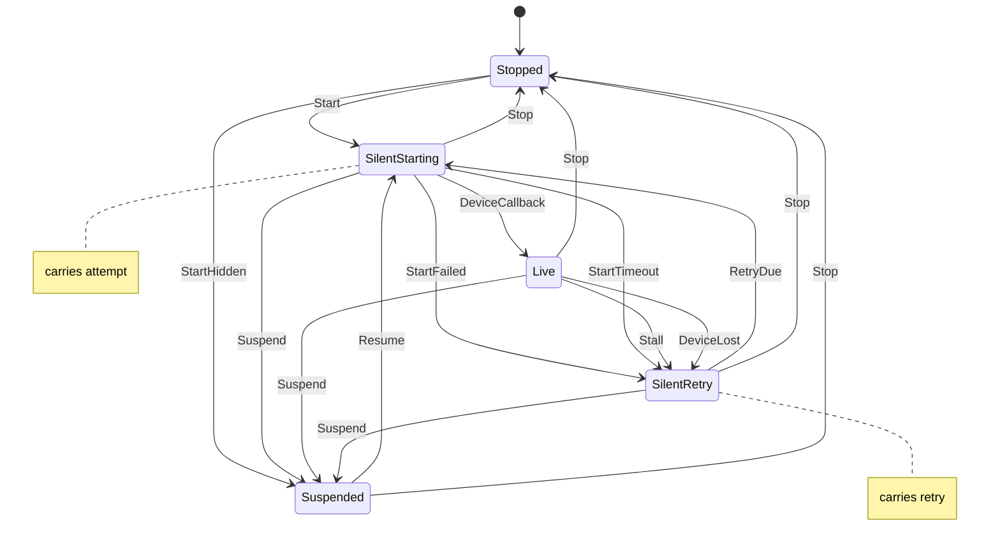

# audio_out

<!-- GENERATED by `npm run kit:diagrams` from src/kit/defs/audio_out.json. Do not edit. -->

Who consumes one AudioOut's queue (src/audio/out.ts): nxnative's state, backend, start_phase and stalled / retry fields as one machine. Stopped: nobody; the guest-visible state is Stopped here and Started everywhere else. SilentStarting: the silent sink consumes on the guest clock while the device is asked to run (an AudioContext waits for a user gesture as long as it takes; with no device attached this state lasts); it carries when the attempt began and the backoff reached. Live: the device mixer consumes. SilentRetry: the device failed to start, delivered no callback within 1 s of running, stopped calling back for 200 ms or was taken away; the silent sink consumes and the device is asked again at the time the state carries, 1, 2, 4, 8, 8 ... s apart. Suspended: the page is hidden; the silent sink consumes and nothing is retried. Reaching Live or Stopped forgets the backoff.

Machine id 3. Any (state, event) pair not listed below is refused: the state stays, `step` returns false and a `[RED] ` line is logged.

| # | State | Carries |
|---|---|---|
| 0 | Stopped (initial) |  |
| 1 | SilentStarting | attempt: host microseconds when the attempt began << 4 | backoff index (0 = none, 1..4 = 1, 2, 4, 8 s) |
| 2 | Live |  |
| 3 | SilentRetry | retry: host microseconds of the next attempt << 4 | backoff index (1..4) |
| 4 | Suspended |  |

| From | Event (#) | To |
|---|---|---|
| Stopped | Start (0) | SilentStarting |
| Stopped | StartHidden (1) | Suspended |
| SilentStarting | DeviceCallback (2) | Live |
| SilentStarting | StartFailed (3) | SilentRetry |
| SilentStarting | StartTimeout (4) | SilentRetry |
| Live | Stall (5) | SilentRetry |
| Live | DeviceLost (6) | SilentRetry |
| SilentRetry | RetryDue (7) | SilentStarting |
| SilentStarting | Suspend (8) | Suspended |
| Live | Suspend (8) | Suspended |
| SilentRetry | Suspend (8) | Suspended |
| Suspended | Resume (9) | SilentStarting |
| SilentStarting | Stop (10) | Stopped |
| Live | Stop (10) | Stopped |
| SilentRetry | Stop (10) | Stopped |
| Suspended | Stop (10) | Stopped |
