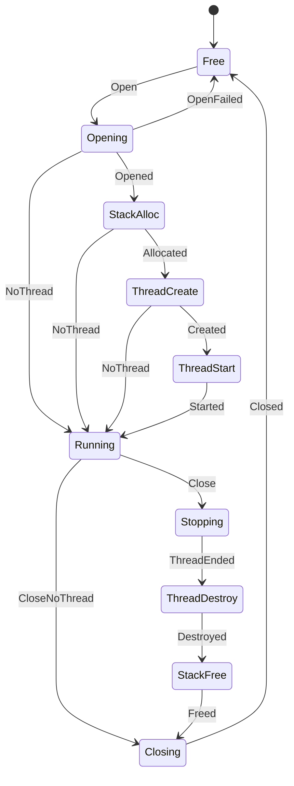

# audio_ren

<!-- GENERATED by `npm run kit:diagrams` from src/kit/defs/audio_ren.json. Do not edit. -->

One audio renderer the host opened (src/audio/ren.ts; nxnative dm/host/hle_audren.c ar_t: handle[0], open, render_tt). The renderer itself is the SDK's own, opened for CPU rendering with manual execution; this is the host's part of its life, each state one call into the SDK that the calling guest thread is running. Opening: the SDK's OpenAudioRenderer (a nested OpenAudioRenderer of that thread goes straight to the SDK). StackAlloc, ThreadCreate, ThreadStart: the render thread is made as nxnative's dm_guest_thread_spawn makes it, with the SDK's malloc, nn::os::CreateThread and StartThread, so it is a thread of the SDK's like any other. NoThread: the SDK lacks one of them or refused; the renderer is open and only the game's updates render. Running: the render thread drives ExecuteAudioRendererRendering, one frame per block its output hands back. Stopping: CloseAudioRenderer waits for the render thread to end (nn::os::WaitThread), because the thread may be inside the renderer the SDK is about to free; ThreadDestroy and StackFree give the thread back. Closing: the SDK's CloseAudioRenderer; then the work buffer the host supplied and the renderer's own event are released.

Machine id 4. Any (state, event) pair not listed below is refused: the state stays, `step` returns false and a `[RED] ` line is logged.

| # | State | Carries |
|---|---|---|
| 0 | Free (initial) |  |
| 1 | Opening |  |
| 2 | StackAlloc |  |
| 3 | ThreadCreate |  |
| 4 | ThreadStart |  |
| 5 | Running |  |
| 6 | Stopping |  |
| 7 | ThreadDestroy |  |
| 8 | StackFree |  |
| 9 | Closing |  |

| From | Event (#) | To |
|---|---|---|
| Free | Open (0) | Opening |
| Opening | Opened (1) | StackAlloc |
| Opening | OpenFailed (2) | Free |
| Opening | NoThread (6) | Running |
| StackAlloc | Allocated (3) | ThreadCreate |
| StackAlloc | NoThread (6) | Running |
| ThreadCreate | Created (4) | ThreadStart |
| ThreadCreate | NoThread (6) | Running |
| ThreadStart | Started (5) | Running |
| Running | Close (7) | Stopping |
| Running | CloseNoThread (8) | Closing |
| Stopping | ThreadEnded (9) | ThreadDestroy |
| ThreadDestroy | Destroyed (10) | StackFree |
| StackFree | Freed (11) | Closing |
| Closing | Closed (12) | Free |
