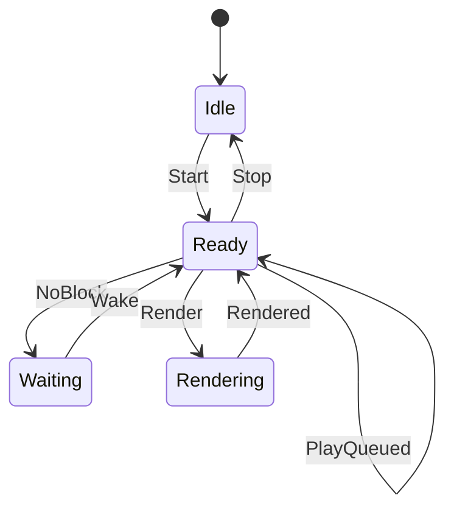

# audio_ren_thread

<!-- GENERATED by `npm run kit:diagrams` from src/kit/defs/audio_ren_thread.json. Do not edit. -->

The host's render thread of one renderer (src/audio/ren.ts; nxnative render_main): a guest thread whose body is host code. Idle: no thread. Ready: the loop looks at its output. Waiting: all four blocks are in flight; it waits for the output to hand one back (the release event, at most 10 ms). Rendering: the SDK's ExecuteAudioRendererRendering runs on the thread (it generates commands, processes them and signals the game's renderer event; the host takes the DeviceSink's samples inside it). PlayQueued: a catch-up frame an update rendered is played in place of a render. Stop: the renderer is no longer Running; the output is closed and the thread ends.

Machine id 5. Any (state, event) pair not listed below is refused: the state stays, `step` returns false and a `[RED] ` line is logged.

| # | State | Carries |
|---|---|---|
| 0 | Idle (initial) |  |
| 1 | Ready |  |
| 2 | Waiting |  |
| 3 | Rendering |  |

| From | Event (#) | To |
|---|---|---|
| Idle | Start (0) | Ready |
| Ready | NoBlock (1) | Waiting |
| Waiting | Wake (2) | Ready |
| Ready | Render (3) | Rendering |
| Rendering | Rendered (4) | Ready |
| Ready | PlayQueued (5) | Ready |
| Ready | Stop (6) | Idle |
