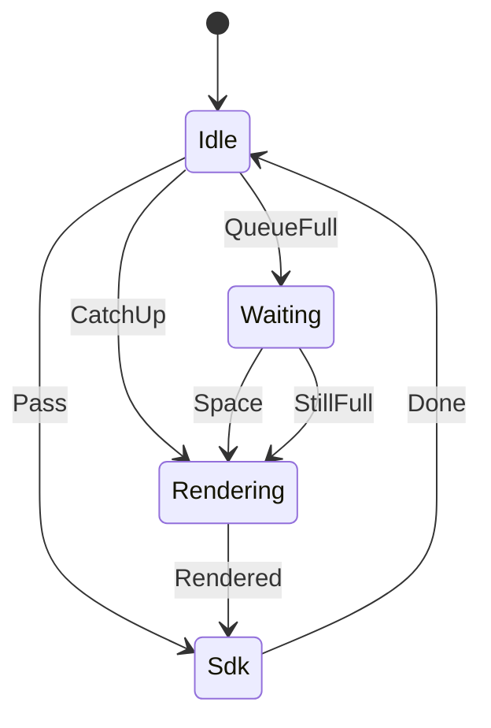

# audio_ren_update

<!-- GENERATED by `npm run kit:diagrams` from src/kit/defs/audio_ren_update.json. Do not edit. -->

One AudioRenderSystem::Update (the game's RequestUpdateAudioRenderer) as the host takes it over (src/audio/ren.ts; nxnative h_ars_Update). At least one frame must be rendered between two updates (an effect's initialization lives for one update only). Pass: a frame was rendered since the last update, or this is the first. CatchUp: none was; a catch-up frame is rendered on this thread first, into the queue the render thread plays from. QueueFull / Waiting: the queue of four is full; the update waits for the render thread to play one (at most 50 ms), so that catch-up frames keep real time. Space: there is room now. StillFull: the output stopped; the frame is rendered and discarded. Sdk: the SDK's own Update runs.

Machine id 6. Any (state, event) pair not listed below is refused: the state stays, `step` returns false and a `[RED] ` line is logged.

| # | State | Carries |
|---|---|---|
| 0 | Idle (initial) |  |
| 1 | Waiting |  |
| 2 | Rendering |  |
| 3 | Sdk |  |

| From | Event (#) | To |
|---|---|---|
| Idle | Pass (0) | Sdk |
| Idle | CatchUp (1) | Rendering |
| Idle | QueueFull (2) | Waiting |
| Waiting | Space (3) | Rendering |
| Waiting | StillFull (4) | Rendering |
| Rendering | Rendered (5) | Sdk |
| Sdk | Done (6) | Idle |
