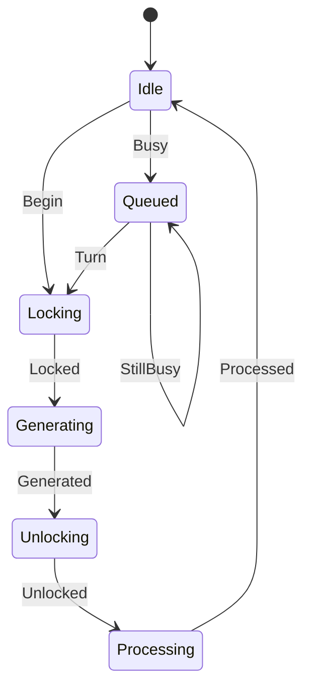

# audio_render

<!-- GENERATED by `npm run kit:diagrams` from src/kit/defs/audio_render.json. Do not edit. -->

One render of one frame (src/audio/ren.ts; nxnative render_once), made of calls into the SDK that the calling guest thread runs one after the other and that may block or be preempted in between. Queued: another thread's render is in progress (nxnative's g_render_mu: the two callers, render thread and catch-up, share the SDK's command buffer); it waits for the turn. Locking: the SDK's update lock is being taken (command generation must exclude the game's RequestUpdate). Generating: AudioRenderSystem::GenerateCommand. Unlocking: the update lock is given back. Processing: CommandListProcessor::Process, outside the lock; when it returns the host walks the command list and takes the DeviceSink's mix buffers.

Machine id 7. Any (state, event) pair not listed below is refused: the state stays, `step` returns false and a `[RED] ` line is logged.

| # | State | Carries |
|---|---|---|
| 0 | Idle (initial) |  |
| 1 | Queued |  |
| 2 | Locking |  |
| 3 | Generating |  |
| 4 | Unlocking |  |
| 5 | Processing |  |

| From | Event (#) | To |
|---|---|---|
| Idle | Begin (0) | Locking |
| Idle | Busy (1) | Queued |
| Queued | StillBusy (2) | Queued |
| Queued | Turn (3) | Locking |
| Locking | Locked (4) | Generating |
| Generating | Generated (5) | Unlocking |
| Unlocking | Unlocked (6) | Processing |
| Processing | Processed (7) | Idle |
