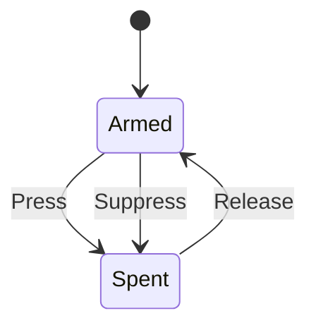

# button_latch

<!-- GENERATED by `npm run kit:diagrams` from src/kit/defs/button_latch.json. Do not edit. -->

One controller button as the Home-button quit machine sees it (home_quit.ts keeps three: Home, A, B). Armed: the button has been seen up, so its next press counts. Spent: it is down, or it was down when it could not count (held while the prompt opened, held through a focus loss), and must be let go before it counts again.

Machine id 0. Any (state, event) pair not listed below is refused: the state stays, `step` returns false and a `[RED] ` line is logged.

| # | State | Carries |
|---|---|---|
| 0 | Armed (initial) |  |
| 1 | Spent |  |

| From | Event (#) | To |
|---|---|---|
| Armed | Press (0) | Spent |
| Spent | Release (1) | Armed |
| Armed | Suppress (2) | Spent |
