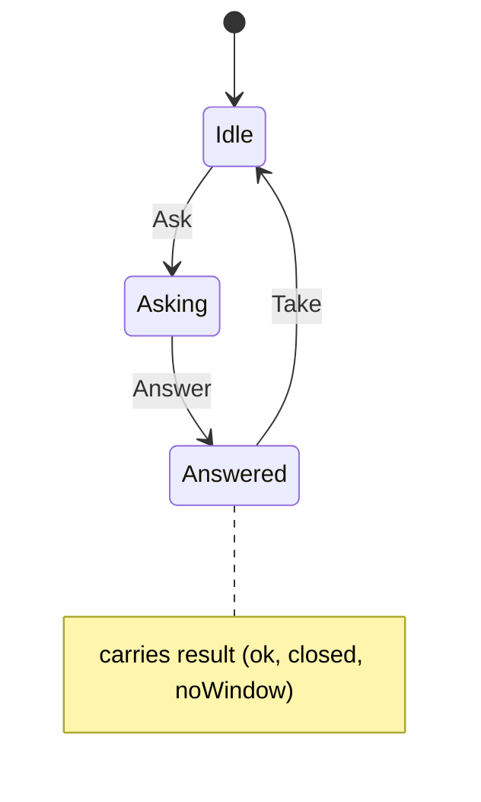

# ctrl_prompt

<!-- GENERATED by `npm run kit:diagrams` from src/kit/defs/ctrl_prompt.json. Do not edit. -->

The controller applet's prompt (nn::hid::ShowControllerSupport with fewer players than the game's minimum; what nxnative's front_ctrl_support blocks in, hle_hid.c). Ask: the import hle_ctrl_prompt is about to show the embedder's prompt, which stays up while controllers join. Answer: the embedder called hle_ctrl_answer with 1 enough players pressed OK or 2 the player closed it (inside the import or any time later), or the import said there is no window (3). Take: the take-over that asked read the answer. One prompt at a time, as one applet.

Machine id 19. Any (state, event) pair not listed below is refused: the state stays, `step` returns false and a `[RED] ` line is logged.

| # | State | Carries |
|---|---|---|
| 0 | Idle (initial) |  |
| 1 | Asking |  |
| 2 | Answered | result: 1 ok, 2 closed, 3 noWindow |

| From | Event (#) | To |
|---|---|---|
| Idle | Ask (0) | Asking |
| Asking | Answer (1) | Answered |
| Answered | Take (2) | Idle |
