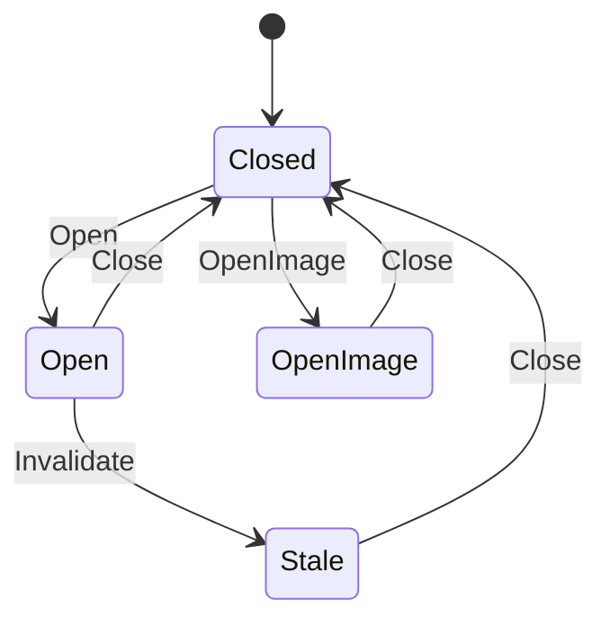

# fs_dir

<!-- GENERATED by `npm run kit:diagrams` from src/kit/defs/fs_dir.json. Do not edit. -->

One slot of the directory handle table. Open: a directory of a save, listed from the snapshot of its entries taken at open. OpenImage: a directory of a RomFS image, listed by walking its child chains. Stale: the save was rebuilt from its committed version while the handle was open.

Machine id 5. Any (state, event) pair not listed below is refused: the state stays, `step` returns false and a `[RED] ` line is logged.

| # | State | Carries |
|---|---|---|
| 0 | Closed (initial) |  |
| 1 | Open |  |
| 2 | OpenImage |  |
| 3 | Stale |  |

| From | Event (#) | To |
|---|---|---|
| Closed | Open (0) | Open |
| Closed | OpenImage (1) | OpenImage |
| Open | Close (2) | Closed |
| OpenImage | Close (2) | Closed |
| Stale | Close (2) | Closed |
| Open | Invalidate (3) | Stale |
