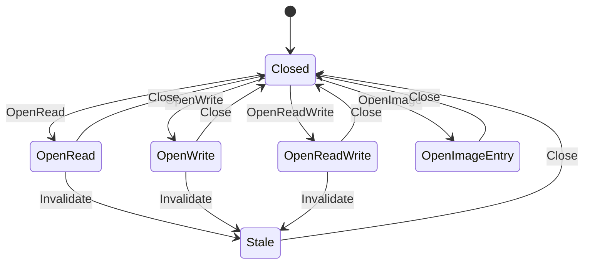

# fs_file

<!-- GENERATED by `npm run kit:diagrams` from src/kit/defs/fs_file.json. Do not edit. -->

One slot of the file handle table. nxnative keeps the open mode and the transaction of a file in arrays indexed by host fd and tells an image entry by a bit of the handle; here the slot's state says what the handle is. OpenRead, OpenWrite (write only: opened with Write or AllowAppend and without Read) and OpenReadWrite are files of a save; OpenImageEntry is a file of a RomFS image (read only, no storage object of its own). Stale: the save was rebuilt from its committed version while the handle was open (a refused commit); every operation fails until it is closed.

Machine id 6. Any (state, event) pair not listed below is refused: the state stays, `step` returns false and a `[RED] ` line is logged.

| # | State | Carries |
|---|---|---|
| 0 | Closed (initial) |  |
| 1 | OpenRead |  |
| 2 | OpenWrite |  |
| 3 | OpenReadWrite |  |
| 4 | OpenImageEntry |  |
| 5 | Stale |  |

| From | Event (#) | To |
|---|---|---|
| Closed | OpenRead (0) | OpenRead |
| Closed | OpenWrite (1) | OpenWrite |
| Closed | OpenReadWrite (2) | OpenReadWrite |
| Closed | OpenImage (3) | OpenImageEntry |
| OpenRead | Close (4) | Closed |
| OpenWrite | Close (4) | Closed |
| OpenReadWrite | Close (4) | Closed |
| OpenImageEntry | Close (4) | Closed |
| Stale | Close (4) | Closed |
| OpenRead | Invalidate (5) | Stale |
| OpenWrite | Invalidate (5) | Stale |
| OpenReadWrite | Invalidate (5) | Stale |
