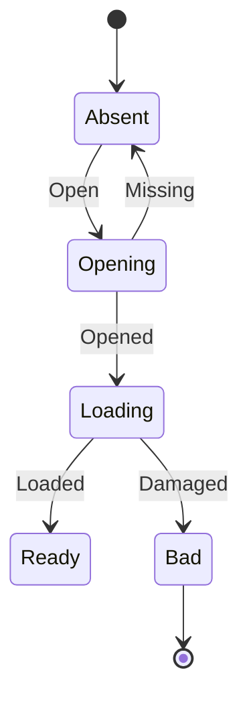

# fs_image

<!-- GENERATED by `npm run kit:diagrams` from src/kit/defs/fs_image.json. Do not edit. -->

One RomFS image (the game's, an add-on content's, a system data archive's). Opening: the storage device is being opened. Loading: the header and the four tables are being read and checked. Ready: every table reference was checked, lookups and reads need no further checks. Bad: the image was refused (damaged or cut short); it stays refused.

Machine id 11. Any (state, event) pair not listed below is refused: the state stays, `step` returns false and a `[RED] ` line is logged.

| # | State | Carries |
|---|---|---|
| 0 | Absent (initial) |  |
| 1 | Opening |  |
| 2 | Loading |  |
| 3 | Ready |  |
| 4 | Bad (final) |  |

| From | Event (#) | To |
|---|---|---|
| Absent | Open (0) | Opening |
| Opening | Opened (1) | Loading |
| Opening | Missing (2) | Absent |
| Loading | Loaded (3) | Ready |
| Loading | Damaged (4) | Bad |
