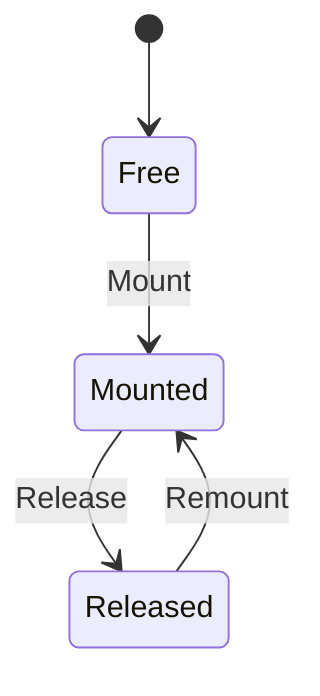

# fs_mount

<!-- GENERATED by `npm run kit:diagrams` from src/kit/defs/fs_mount.json. Do not edit. -->

One entry of the mount-name table (512 entries, as nxnative). Entries are permanent: Unmount changes nothing, except that an add-on content mount releases its name (Released: no name lookup matches it, handles opened through it keep working) and a later mount of the same add-on takes the entry back under the new name.

Machine id 5. Any (state, event) pair not listed below is refused: the state stays, `step` returns false and a `[RED] ` line is logged.

| # | State | Carries |
|---|---|---|
| 0 | Free (initial) |  |
| 1 | Mounted |  |
| 2 | Released |  |

| From | Event (#) | To |
|---|---|---|
| Free | Mount (0) | Mounted |
| Mounted | Release (1) | Released |
| Released | Remount (2) | Mounted |
