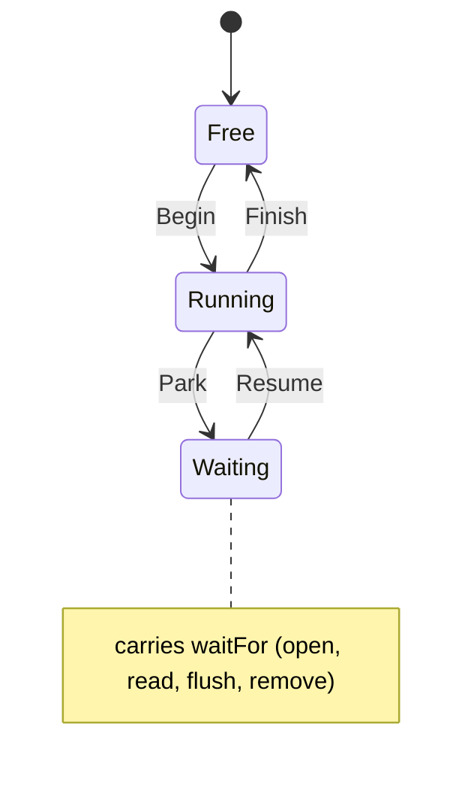

# fs_pend

<!-- GENERATED by `npm run kit:diagrams` from src/kit/defs/fs_pend.json. Do not edit. -->

One call context of the file system: a guest call that needs storage. Running: the call is executing. Waiting: a storage call did not finish at once; fs_call returned 'pending' with this context's token, the guest thread is parked, and fs_complete(token, status) resumes the call where it stopped. In synchronous mode a context goes Free, Running, Free.

Machine id 13. Any (state, event) pair not listed below is refused: the state stays, `step` returns false and a `[RED] ` line is logged.

| # | State | Carries |
|---|---|---|
| 0 | Free (initial) |  |
| 1 | Running |  |
| 2 | Waiting | waitFor: 1 open, 2 read, 3 flush, 4 remove |

| From | Event (#) | To |
|---|---|---|
| Free | Begin (0) | Running |
| Running | Park (1) | Waiting |
| Waiting | Resume (2) | Running |
| Running | Finish (3) | Free |
