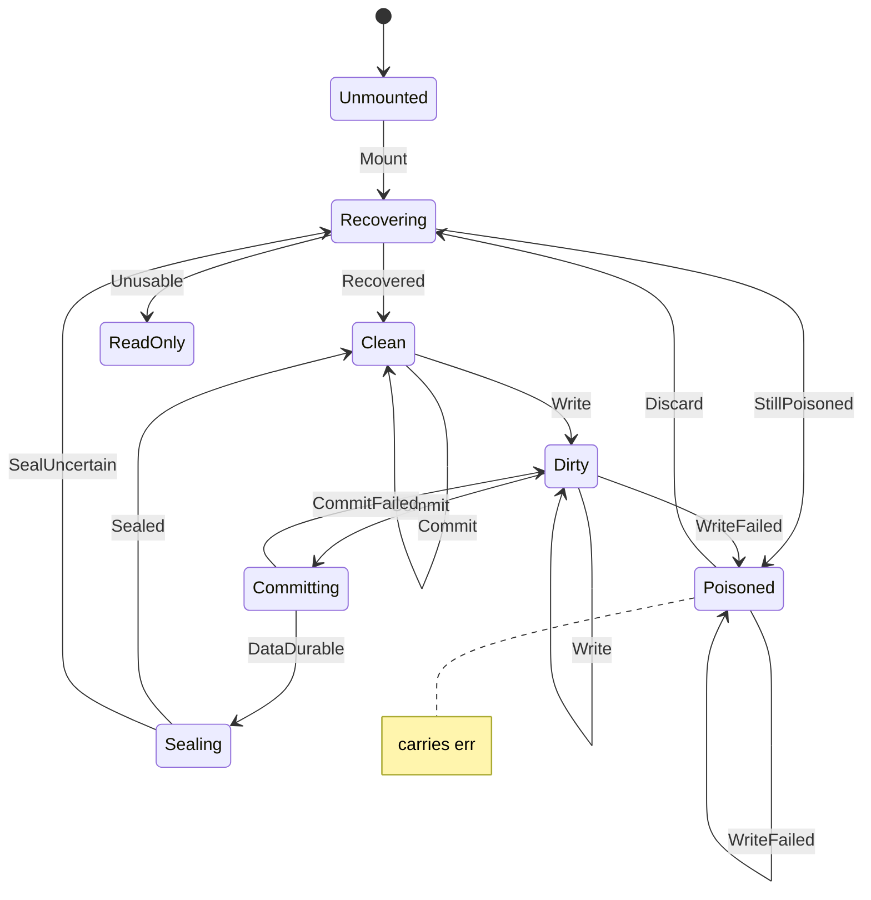

# fs_save

<!-- GENERATED by `npm run kit:diagrams` from src/kit/defs/fs_save.json. Do not edit. -->

One save backing (account save, device save, a cache storage, temporary storage) and its transaction. nxnative encodes this in which fields of a mount are set (commit, txn_root, ro) plus an atomic poison flag (dm/host/hle_fs.c); here it is one state. Recovering reads the container: at mount, after a refused commit (the working copy is discarded and rebuilt from the committed version) and when the outcome of a commit is not known. Clean: the working copy is the committed version. Dirty: it differs. Committing: the new manifest is written and the first barrier is awaited; nothing committed has changed yet. Sealing: the superblock slot is written (the one atomic step) and the second barrier is awaited. Poisoned: a storage write failed in this transaction; the next commit is refused. ReadOnly: the container could not be opened or read; every write fails, commits are no-ops.

Machine id 14. Any (state, event) pair not listed below is refused: the state stays, `step` returns false and a `[RED] ` line is logged.

| # | State | Carries |
|---|---|---|
| 0 | Unmounted (initial) |  |
| 1 | Recovering |  |
| 2 | Clean |  |
| 3 | Dirty |  |
| 4 | Committing |  |
| 5 | Sealing |  |
| 6 | Poisoned | err: errno of the first failed write of the transaction (28 no space, 5 I/O) |
| 7 | ReadOnly |  |

| From | Event (#) | To |
|---|---|---|
| Unmounted | Mount (0) | Recovering |
| Recovering | Recovered (1) | Clean |
| Recovering | Unusable (2) | ReadOnly |
| Recovering | StillPoisoned (3) | Poisoned |
| Clean | Write (4) | Dirty |
| Dirty | Write (4) | Dirty |
| Poisoned | Write (4) | Poisoned |
| Dirty | WriteFailed (5) | Poisoned |
| Poisoned | WriteFailed (5) | Poisoned |
| Clean | Commit (6) | Clean |
| Dirty | Commit (6) | Committing |
| Committing | DataDurable (7) | Sealing |
| Committing | CommitFailed (8) | Dirty |
| Sealing | Sealed (9) | Clean |
| Sealing | SealUncertain (10) | Recovering |
| Poisoned | Discard (11) | Recovering |
