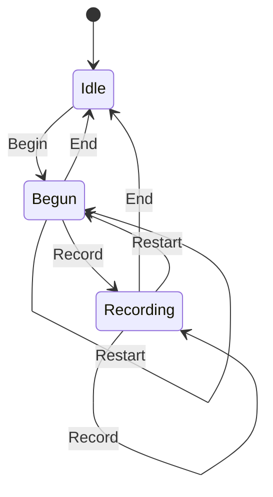

# gfx_cmdbuf

<!-- GENERATED by `npm run kit:diagrams` from src/kit/defs/gfx_cmdbuf.json. Do not edit. -->

Recording state of one NVN command buffer (src/gfx/cmd.ts; nxnative cmd_t.recording 0 / 2 / 1). Begun is a recording with no record yet: its first record becomes the command handle. AddCommandMemory is not an event: memory may be added in any state. Restart is BeginRecording while a recording is open, which nxnative reports red and restarts.

Machine id 11. Any (state, event) pair not listed below is refused: the state stays, `step` returns false and a `[RED] ` line is logged.

| # | State | Carries |
|---|---|---|
| 0 | Idle (initial) |  |
| 1 | Begun |  |
| 2 | Recording |  |

| From | Event (#) | To |
|---|---|---|
| Idle | Begin (0) | Begun |
| Begun | Record (1) | Recording |
| Recording | Record (1) | Recording |
| Begun | End (2) | Idle |
| Recording | End (2) | Idle |
| Begun | Restart (3) | Begun |
| Recording | Restart (3) | Begun |
