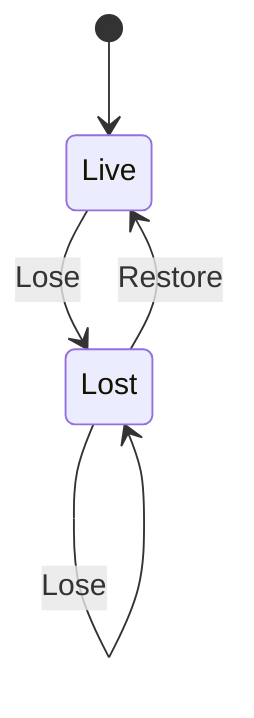

# gfx_device

<!-- GENERATED by `npm run kit:diagrams` from src/kit/defs/gfx_device.json. Do not edit. -->

The host GPU device (GPUDevice) as the recorder knows it (src/gfx/device.ts). Lose: the replayer saw GPUDevice.lost; submissions are still lowered, the replayer executes them against the dead device (nothing is drawn), fences complete. Restore: the embedder gave the replayer a new device: host textures, pipelines and buffers are made again from guest state (gfx_texture Lost, gfx_pipeline Reset). A device lost again before it is restored stays Lost.

Machine id 9. Any (state, event) pair not listed below is refused: the state stays, `step` returns false and a `[RED] ` line is logged.

| # | State | Carries |
|---|---|---|
| 0 | Live (initial) |  |
| 1 | Lost |  |

| From | Event (#) | To |
|---|---|---|
| Live | Lose (0) | Lost |
| Lost | Lose (0) | Lost |
| Lost | Restore (1) | Live |
