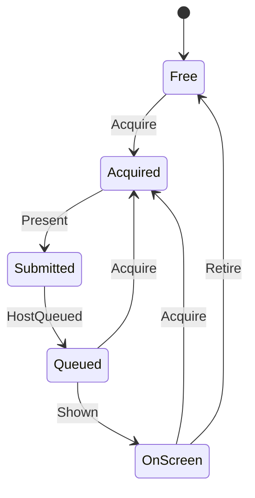

# gfx_image

<!-- GENERATED by `npm run kit:diagrams` from src/kit/defs/gfx_image.json. Do not edit. -->

One texture of an NVN window's swap chain (src/gfx/window.ts). Acquire hands it to the game, Present (nvnQueuePresentTexture) puts the blit to the canvas in the host stream, HostQueued is the replayer having submitted that blit, Shown its completion on the GPU; Retire frees the image that was on screen before. Nothing blocks in a browser turn, so Acquire also takes an image that is still Queued or OnScreen when the game comes round to it (the kernel will pace acquires on the sync later).

Machine id 13. Any (state, event) pair not listed below is refused: the state stays, `step` returns false and a `[RED] ` line is logged.

| # | State | Carries |
|---|---|---|
| 0 | Free (initial) |  |
| 1 | Acquired |  |
| 2 | Submitted |  |
| 3 | Queued |  |
| 4 | OnScreen |  |

| From | Event (#) | To |
|---|---|---|
| Free | Acquire (0) | Acquired |
| Queued | Acquire (0) | Acquired |
| OnScreen | Acquire (0) | Acquired |
| Acquired | Present (1) | Submitted |
| Submitted | HostQueued (2) | Queued |
| Queued | Shown (3) | OnScreen |
| OnScreen | Retire (4) | Free |
