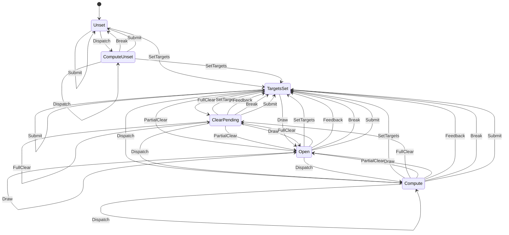

# gfx_pass

<!-- GENERATED by `npm run kit:diagrams` from src/kit/defs/gfx_pass.json. Do not edit. -->

Render pass of one NVN queue as WebGPU needs it (src/gfx/lower.ts). WebGPU fixes attachments and load actions when a pass begins, has no clear inside a pass, and refuses to sample a texture attached to the open pass. TargetsSet: targets known, no pass. ClearPending: full clears wait to become the load actions of the next pass. Open: a pass is open. Draw and PartialClear (drawn as a triangle) open or continue the pass; FullClear in Open ends it and waits again; Feedback is a draw that samples one of its own targets: the pass ends, the texture is copied, and the Draw that follows reopens with load. Dispatch is a compute dispatch: the render pass ends (pending clears land first) and a compute pass opens, which consecutive dispatches share; Compute keeps the render targets that were set, ComputeUnset is a dispatch before any were. Break is anything that cannot be inside a pass (copy, resolve, fence, present); Submit is the end of a submission. Both land pending clears with a pass of their own.

Machine id 18. Any (state, event) pair not listed below is refused: the state stays, `step` returns false and a `[RED] ` line is logged.

| # | State | Carries |
|---|---|---|
| 0 | Unset (initial) |  |
| 1 | TargetsSet |  |
| 2 | ClearPending |  |
| 3 | Open |  |
| 4 | ComputeUnset |  |
| 5 | Compute |  |

| From | Event (#) | To |
|---|---|---|
| Unset | SetTargets (0) | TargetsSet |
| TargetsSet | SetTargets (0) | TargetsSet |
| ClearPending | SetTargets (0) | TargetsSet |
| Open | SetTargets (0) | TargetsSet |
| TargetsSet | FullClear (1) | ClearPending |
| ClearPending | FullClear (1) | ClearPending |
| Open | FullClear (1) | ClearPending |
| TargetsSet | PartialClear (2) | Open |
| ClearPending | PartialClear (2) | Open |
| Open | PartialClear (2) | Open |
| TargetsSet | Draw (3) | Open |
| ClearPending | Draw (3) | Open |
| Open | Draw (3) | Open |
| TargetsSet | Feedback (4) | TargetsSet |
| ClearPending | Feedback (4) | TargetsSet |
| Open | Feedback (4) | TargetsSet |
| Unset | Break (5) | Unset |
| TargetsSet | Break (5) | TargetsSet |
| ClearPending | Break (5) | TargetsSet |
| Open | Break (5) | TargetsSet |
| Unset | Submit (6) | Unset |
| TargetsSet | Submit (6) | TargetsSet |
| ClearPending | Submit (6) | TargetsSet |
| Open | Submit (6) | TargetsSet |
| Unset | Dispatch (7) | ComputeUnset |
| ComputeUnset | Dispatch (7) | ComputeUnset |
| TargetsSet | Dispatch (7) | Compute |
| ClearPending | Dispatch (7) | Compute |
| Open | Dispatch (7) | Compute |
| Compute | Dispatch (7) | Compute |
| ComputeUnset | SetTargets (0) | TargetsSet |
| ComputeUnset | Break (5) | Unset |
| ComputeUnset | Submit (6) | Unset |
| Compute | SetTargets (0) | TargetsSet |
| Compute | FullClear (1) | ClearPending |
| Compute | PartialClear (2) | Open |
| Compute | Draw (3) | Open |
| Compute | Feedback (4) | TargetsSet |
| Compute | Break (5) | TargetsSet |
| Compute | Submit (6) | TargetsSet |
