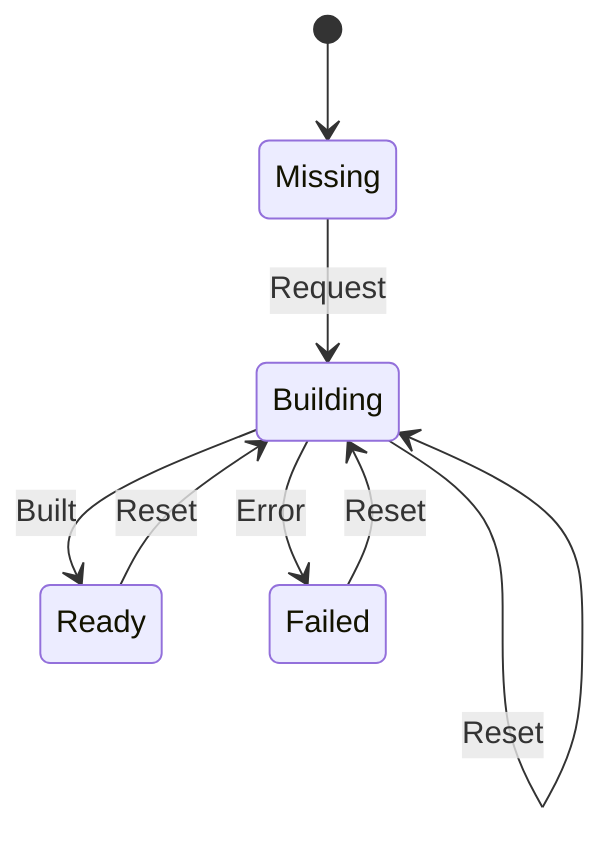

# gfx_pipeline

<!-- GENERATED by `npm run kit:diagrams` from src/kit/defs/gfx_pipeline.json. Do not edit. -->

One entry of the render pipeline cache (src/gfx/pipeline.ts). The key is program + vertex layout + blend, depth-stencil and raster state + target formats. Request is the first draw that needs the key: the replayer starts createRenderPipelineAsync and reports Built or Error (gfx_pipeline_done). A draw in Building is still issued: the replayer creates the pipeline synchronously for it. A draw in Failed is skipped. Compute pipelines (one shader) use the same cache. Reset is the GPU device having been lost and replaced: every pipeline is requested again from the new device.

Machine id 19. Any (state, event) pair not listed below is refused: the state stays, `step` returns false and a `[RED] ` line is logged.

| # | State | Carries |
|---|---|---|
| 0 | Missing (initial) |  |
| 1 | Building |  |
| 2 | Ready |  |
| 3 | Failed |  |

| From | Event (#) | To |
|---|---|---|
| Missing | Request (0) | Building |
| Building | Built (1) | Ready |
| Building | Error (2) | Failed |
| Building | Reset (3) | Building |
| Ready | Reset (3) | Building |
| Failed | Reset (3) | Building |
