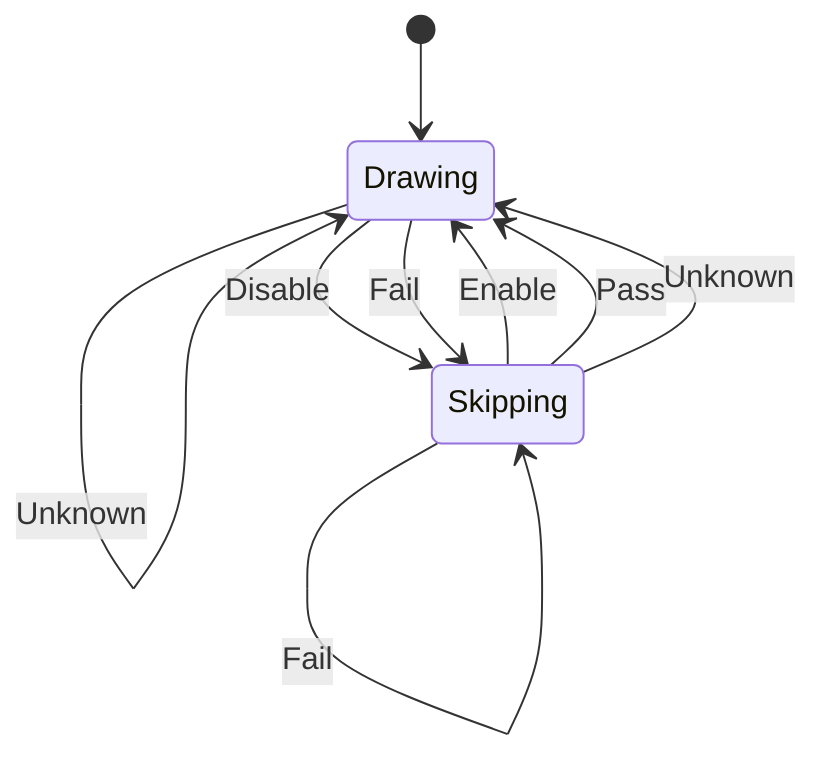

# gfx_render_enable

<!-- GENERATED by `npm run kit:diagrams` from src/kit/defs/gfx_render_enable.json. Do not edit. -->

NVN's render enable of a queue as the lowering keeps it (src/gfx/report.ts; nxnative nvn_mtl.m g_rc_skip), with the game profile's render_cond. Drawing: draws and clears are lowered. Skipping: a block the game disabled, or whose condition was evaluated false, is being walked: its draws and clears are dropped (compute dispatches, copies and state are not). Enable and Disable are nvnCommandBufferSetRenderEnable(true / false). SetRenderEnableConditional compares the 64-bit counters at an address and 16 bytes after it when the command is lowered: Pass (the condition holds), Fail (it does not), Unknown (one of the counters cannot be known on the CPU: a counter this port does not count, or a record outside memory): an unknown condition draws, because only an evaluated condition is a valid reason to skip. The state is queue state: it lasts across submissions until the next command sets it.

Machine id 20. Any (state, event) pair not listed below is refused: the state stays, `step` returns false and a `[RED] ` line is logged.

| # | State | Carries |
|---|---|---|
| 0 | Drawing (initial) |  |
| 1 | Skipping |  |

| From | Event (#) | To |
|---|---|---|
| Drawing | Enable (0) | Drawing |
| Skipping | Enable (0) | Drawing |
| Drawing | Disable (1) | Skipping |
| Skipping | Disable (1) | Skipping |
| Drawing | Pass (2) | Drawing |
| Skipping | Pass (2) | Drawing |
| Drawing | Fail (3) | Skipping |
| Skipping | Fail (3) | Skipping |
| Drawing | Unknown (4) | Drawing |
| Skipping | Unknown (4) | Drawing |
