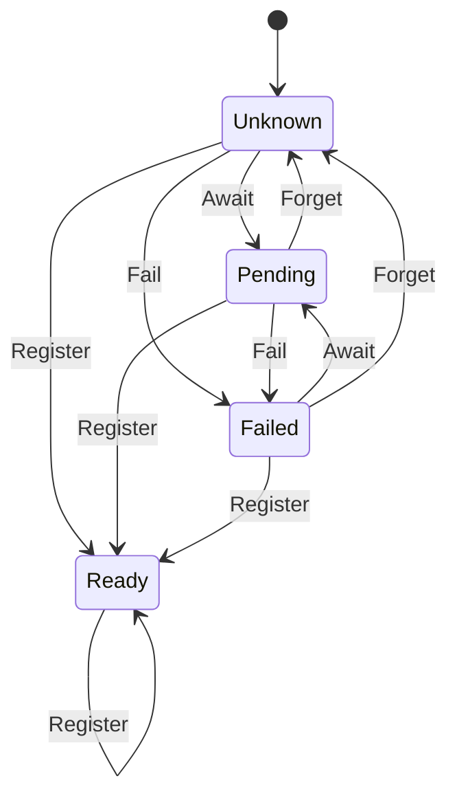

# gfx_shader

<!-- GENERATED by `npm run kit:diagrams` from src/kit/defs/gfx_shader.json. Do not edit. -->

One shader key as the recorder knows it (src/gfx/shader.ts): sha256(control section + code)[0..8] of a stage a program was given. Unknown: nobody has said anything about the key; a draw that needs it is skipped and the key is reported missing, red, once. Await: the embedder is fetching or translating it (gfx_shader_pending 1): its draws are skipped without a line. Fail: the embedder could not get it (2) and has said so itself: skipped without a line of the recorder's. Register: its reflection record arrived (gfx_shader_register): draws go on; registered again, every pipeline built from it is requested again (gfx_pipeline Reset). Forget (0): the embedder gave up waiting, the key is unknown again.

Machine id 20. Any (state, event) pair not listed below is refused: the state stays, `step` returns false and a `[RED] ` line is logged.

| # | State | Carries |
|---|---|---|
| 0 | Unknown (initial) |  |
| 1 | Pending |  |
| 2 | Failed |  |
| 3 | Ready |  |

| From | Event (#) | To |
|---|---|---|
| Unknown | Await (0) | Pending |
| Failed | Await (0) | Pending |
| Unknown | Fail (1) | Failed |
| Pending | Fail (1) | Failed |
| Unknown | Register (2) | Ready |
| Pending | Register (2) | Ready |
| Failed | Register (2) | Ready |
| Ready | Register (2) | Ready |
| Pending | Forget (3) | Unknown |
| Failed | Forget (3) | Unknown |
