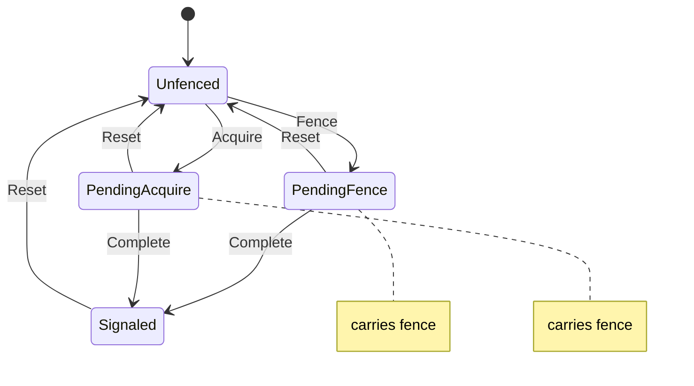

# gfx_sync

<!-- GENERATED by `npm run kit:diagrams` from src/kit/defs/gfx_sync.json. Do not edit. -->

An NVN sync object, kept inside the guest's NVNsync (src/gfx/sync.ts; nxnative sync_t.fenced and fence). The pending states carry the fence number they wait for: PendingFence from nvnQueueFenceSync, PendingAcquire from nvnWindowAcquireTexture. Complete is nvnSyncWait finding the fence done (gfx_fence_done). A fenced sync is fenced again through Reset.

Machine id 12. Any (state, event) pair not listed below is refused: the state stays, `step` returns false and a `[RED] ` line is logged.

| # | State | Carries |
|---|---|---|
| 0 | Unfenced (initial) |  |
| 1 | PendingFence | fence: fence number |
| 2 | PendingAcquire | fence: fence number |
| 3 | Signaled |  |

| From | Event (#) | To |
|---|---|---|
| Unfenced | Fence (0) | PendingFence |
| Unfenced | Acquire (1) | PendingAcquire |
| PendingFence | Complete (2) | Signaled |
| PendingAcquire | Complete (2) | Signaled |
| PendingFence | Reset (3) | Unfenced |
| PendingAcquire | Reset (3) | Unfenced |
| Signaled | Reset (3) | Unfenced |
