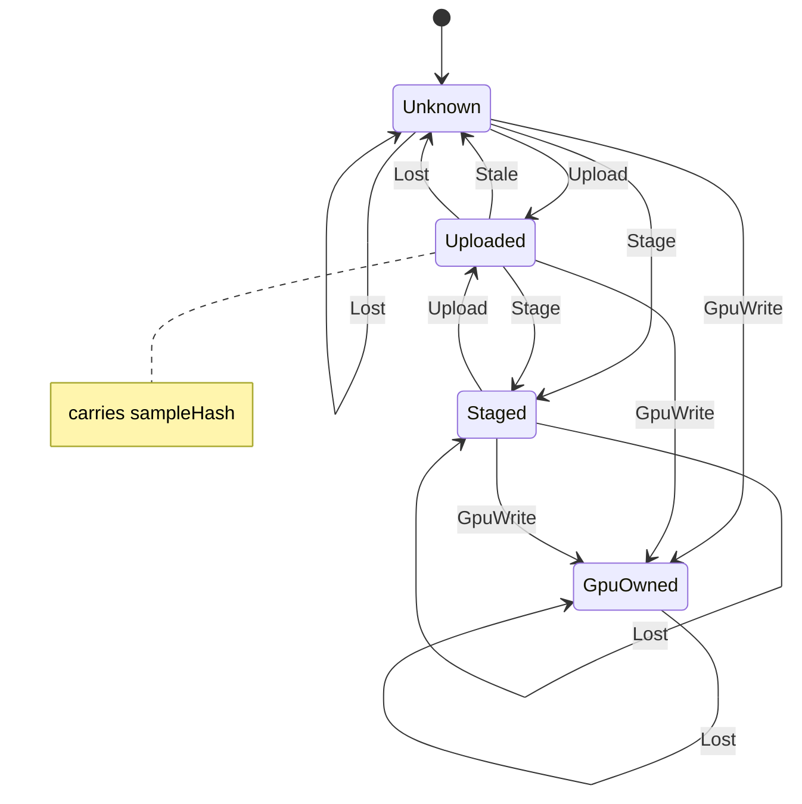

# gfx_texture

<!-- GENERATED by `npm run kit:diagrams` from src/kit/defs/gfx_texture.json. Do not edit. -->

Where a texture's content is, one instance per live texture (src/gfx/texcontent.ts). WebAssembly cannot protect pages, so CPU writes to texture storage are not seen as they happen (nxnative nvn_dirty.c); the state is checked when a submission first needs the texture. Unknown: the host texture holds nothing the recorder vouches for; its first use uploads the storage (deswizzled). Uploaded carries the sampled hash of the storage it was uploaded from: at the first use in each later submission the sampled hash is taken again (and the full hash when the range was flushed, or periodically within a budget), and a difference is Stale: uploaded again. GpuOwned: a render pass, a copy or a clear wrote it; guest memory no longer describes it and it is never uploaded again. Staged: texels were written into the storage by a command or call (CopyBufferToTexture, WriteTexels) while the storage owned the content: the next use uploads, and a GPU write that keeps the old content (a pass that loads, a partial copy) uploads first. Lost is the GPU device being lost: what was uploaded is uploaded again from the storage; a GpuOwned texture's content is gone and stays GpuOwned (it is drawn again or stays empty).

Machine id 14. Any (state, event) pair not listed below is refused: the state stays, `step` returns false and a `[RED] ` line is logged.

| # | State | Carries |
|---|---|---|
| 0 | Unknown (initial) |  |
| 1 | Uploaded | sampleHash: sampled hash of the storage |
| 2 | GpuOwned |  |
| 3 | Staged |  |

| From | Event (#) | To |
|---|---|---|
| Unknown | Upload (0) | Uploaded |
| Uploaded | Stale (1) | Unknown |
| Unknown | GpuWrite (2) | GpuOwned |
| Uploaded | GpuWrite (2) | GpuOwned |
| GpuOwned | GpuWrite (2) | GpuOwned |
| Unknown | Stage (3) | Staged |
| Uploaded | Stage (3) | Staged |
| Staged | Stage (3) | Staged |
| Staged | Upload (0) | Uploaded |
| Staged | GpuWrite (2) | GpuOwned |
| Unknown | Lost (4) | Unknown |
| Uploaded | Lost (4) | Unknown |
| Staged | Lost (4) | Staged |
| GpuOwned | Lost (4) | GpuOwned |
