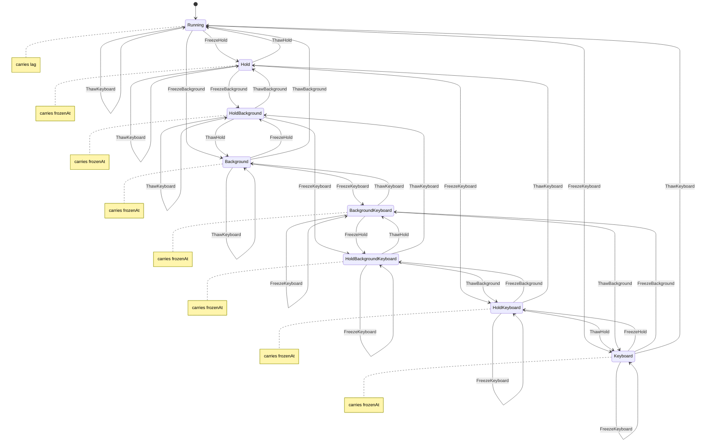

# guest_clock

<!-- GENERATED by `npm run kit:diagrams` from src/kit/defs/guest_clock.json. Do not edit. -->

The guest clock and why it stands still (nxnative hle_os.c guest_clock_freeze_for). The state IS the reason set: its number is the bit mask (bit 0 Hold: a test or loading-screen hold, bit 1 Background: the app is not in focus, bit 2 Keyboard: the system keyboard is up), so one read of the state is one consistent snapshot. The clock runs only in Running, which carries the lag (host ns minus guest ns); every other state carries the guest ns it is frozen at. Freezing a reason that already holds and thawing one that does not are transitions to the same state.

Machine id 35. Any (state, event) pair not listed below is refused: the state stays, `step` returns false and a `[RED] ` line is logged.

| # | State | Carries |
|---|---|---|
| 0 | Running (initial) | lag: host ns minus guest ns while the clock runs |
| 1 | Hold | frozenAt: the guest ns the clock stands at |
| 2 | Background | frozenAt: the guest ns the clock stands at |
| 3 | HoldBackground | frozenAt: the guest ns the clock stands at |
| 4 | Keyboard | frozenAt: the guest ns the clock stands at |
| 5 | HoldKeyboard | frozenAt: the guest ns the clock stands at |
| 6 | BackgroundKeyboard | frozenAt: the guest ns the clock stands at |
| 7 | HoldBackgroundKeyboard | frozenAt: the guest ns the clock stands at |

| From | Event (#) | To |
|---|---|---|
| Running | FreezeHold (0) | Hold |
| Running | ThawHold (1) | Running |
| Running | FreezeBackground (2) | Background |
| Running | ThawBackground (3) | Running |
| Running | FreezeKeyboard (4) | Keyboard |
| Running | ThawKeyboard (5) | Running |
| Hold | FreezeHold (0) | Hold |
| Hold | ThawHold (1) | Running |
| Hold | FreezeBackground (2) | HoldBackground |
| Hold | ThawBackground (3) | Hold |
| Hold | FreezeKeyboard (4) | HoldKeyboard |
| Hold | ThawKeyboard (5) | Hold |
| Background | FreezeHold (0) | HoldBackground |
| Background | ThawHold (1) | Background |
| Background | FreezeBackground (2) | Background |
| Background | ThawBackground (3) | Running |
| Background | FreezeKeyboard (4) | BackgroundKeyboard |
| Background | ThawKeyboard (5) | Background |
| HoldBackground | FreezeHold (0) | HoldBackground |
| HoldBackground | ThawHold (1) | Background |
| HoldBackground | FreezeBackground (2) | HoldBackground |
| HoldBackground | ThawBackground (3) | Hold |
| HoldBackground | FreezeKeyboard (4) | HoldBackgroundKeyboard |
| HoldBackground | ThawKeyboard (5) | HoldBackground |
| Keyboard | FreezeHold (0) | HoldKeyboard |
| Keyboard | ThawHold (1) | Keyboard |
| Keyboard | FreezeBackground (2) | BackgroundKeyboard |
| Keyboard | ThawBackground (3) | Keyboard |
| Keyboard | FreezeKeyboard (4) | Keyboard |
| Keyboard | ThawKeyboard (5) | Running |
| HoldKeyboard | FreezeHold (0) | HoldKeyboard |
| HoldKeyboard | ThawHold (1) | Keyboard |
| HoldKeyboard | FreezeBackground (2) | HoldBackgroundKeyboard |
| HoldKeyboard | ThawBackground (3) | HoldKeyboard |
| HoldKeyboard | FreezeKeyboard (4) | HoldKeyboard |
| HoldKeyboard | ThawKeyboard (5) | Hold |
| BackgroundKeyboard | FreezeHold (0) | HoldBackgroundKeyboard |
| BackgroundKeyboard | ThawHold (1) | BackgroundKeyboard |
| BackgroundKeyboard | FreezeBackground (2) | BackgroundKeyboard |
| BackgroundKeyboard | ThawBackground (3) | Keyboard |
| BackgroundKeyboard | FreezeKeyboard (4) | BackgroundKeyboard |
| BackgroundKeyboard | ThawKeyboard (5) | Background |
| HoldBackgroundKeyboard | FreezeHold (0) | HoldBackgroundKeyboard |
| HoldBackgroundKeyboard | ThawHold (1) | BackgroundKeyboard |
| HoldBackgroundKeyboard | FreezeBackground (2) | HoldBackgroundKeyboard |
| HoldBackgroundKeyboard | ThawBackground (3) | HoldKeyboard |
| HoldBackgroundKeyboard | FreezeKeyboard (4) | HoldBackgroundKeyboard |
| HoldBackgroundKeyboard | ThawKeyboard (5) | HoldBackground |
