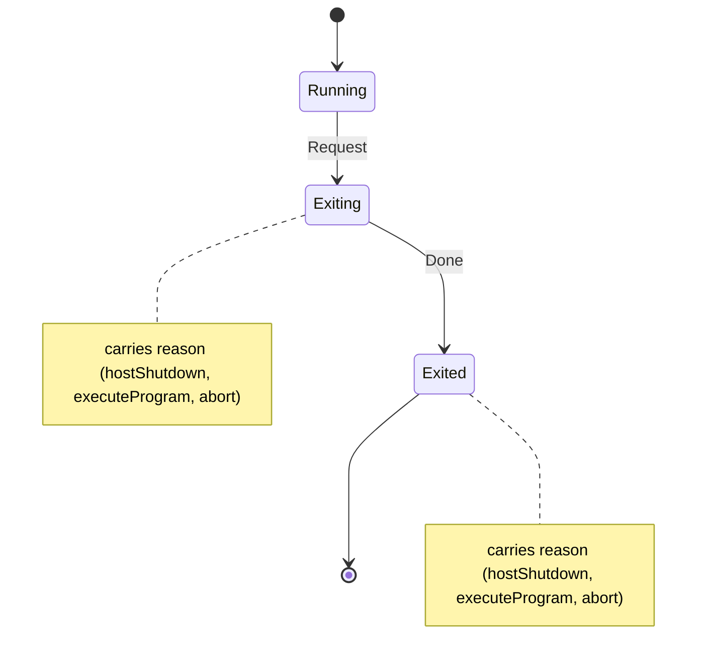

# hle_exit

<!-- GENERATED by `npm run kit:diagrams` from src/kit/defs/hle_exit.json. Do not edit. -->

The exit path of the process as the take-overs see it (port of nxnative hle_lifecycle.c dm_host_shutdown_then, and its callers: SIGTERM / the front end, oe::ExecuteProgram, nn::diag aborts). The first request wins and carries its reason; later ones change nothing. Exiting: the embedder was told (import hle_exit_request) and is stopping audio, graphics and the run loop; Done when it reports back (hle_exit_done).

Machine id 24. Any (state, event) pair not listed below is refused: the state stays, `step` returns false and a `[RED] ` line is logged.

| # | State | Carries |
|---|---|---|
| 0 | Running (initial) |  |
| 1 | Exiting | reason: 1 hostShutdown, 2 executeProgram, 3 abort |
| 2 | Exited (final) | reason: 1 hostShutdown, 2 executeProgram, 3 abort |

| From | Event (#) | To |
|---|---|---|
| Running | Request (0) | Exiting |
| Exiting | Done (1) | Exited |
