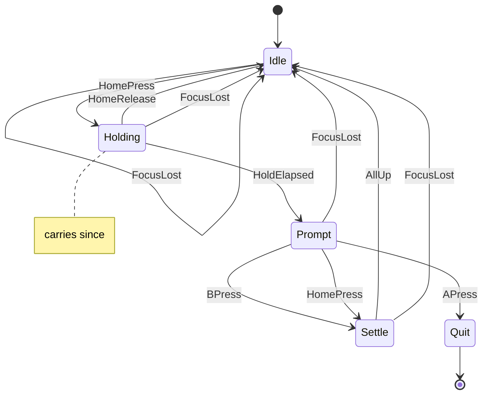

# home_quit

<!-- GENERATED by `npm run kit:diagrams` from src/kit/defs/home_quit.json. Do not edit. -->

Quit with the Home button (port of nxnative dm/host/home_quit.h). Holding Home for 2 s opens a prompt: A quits, B or a new press of Home closes it. Losing the focus closes whatever is shown. The buttons' memory is in three button_latch instances; see src/kit/home_quit.ts for the guards that turn button levels and time into these events.

Machine id 1. Any (state, event) pair not listed below is refused: the state stays, `step` returns false and a `[RED] ` line is logged.

| # | State | Carries |
|---|---|---|
| 0 | Idle (initial) |  |
| 1 | Holding | since: f64 seconds: the time of the press that started the hold |
| 2 | Prompt |  |
| 3 | Settle |  |
| 4 | Quit (final) |  |

| From | Event (#) | To |
|---|---|---|
| Idle | HomePress (0) | Holding |
| Holding | HomeRelease (1) | Idle |
| Holding | HoldElapsed (2) | Prompt |
| Prompt | BPress (3) | Settle |
| Prompt | HomePress (0) | Settle |
| Prompt | APress (4) | Quit |
| Settle | AllUp (5) | Idle |
| Idle | FocusLost (6) | Idle |
| Holding | FocusLost (6) | Idle |
| Prompt | FocusLost (6) | Idle |
| Settle | FocusLost (6) | Idle |
