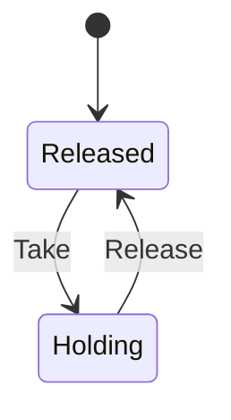

# input_hold

<!-- GENERATED by `npm run kit:diagrams` from src/kit/defs/input_hold.json. Do not edit. -->

One holder of the game's input (src/hle/hid.ts): a library applet or prompt in front of the game. nxnative has one boolean (dm_input_hold), which a second holder's release breaks; here each reason has an instance (#1 the offline web page, #2 the controller applet's prompt, #3 the software keyboard's box, #4 the embedder's own: the Home quit prompt, a menu) and the game reads no buttons and centred sticks while any is Holding. The first Take and the last Release drop the latched presses, as dm_input_hold does on each change: a press made for the applet is not the game's.

Machine id 26. Any (state, event) pair not listed below is refused: the state stays, `step` returns false and a `[RED] ` line is logged.

| # | State | Carries |
|---|---|---|
| 0 | Released (initial) |  |
| 1 | Holding |  |

| From | Event (#) | To |
|---|---|---|
| Released | Take (0) | Holding |
| Holding | Release (1) | Released |
