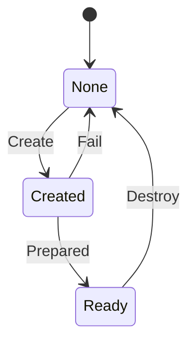

# jit_env

<!-- GENERATED by `npm run kit:diagrams` from src/kit/defs/jit_env.json. Do not edit. -->

One nn::jit environment (port of nxnative dm/host/hle_jit.c: jit_env; src/hle/jit.ts, 4 slots). Create: the embedder loaded the plugin NRO on its own and gave code and data memory (import hle_jit_create). Prepared: the plugin's init, GetVersion, ResolveBasicSymbols, SetupDiagnostics, Configure and OnPrepared have run, as the jit service runs them; GenerateCode and Control are served from here. Fail: the plugin lacks its entry points or is not version 1, and the environment is given back. Destroy: DestroyJitEnvironment ran the plugin's fini and the embedder freed the memory.

Machine id 26. Any (state, event) pair not listed below is refused: the state stays, `step` returns false and a `[RED] ` line is logged.

| # | State | Carries |
|---|---|---|
| 0 | None (initial) |  |
| 1 | Created |  |
| 2 | Ready |  |

| From | Event (#) | To |
|---|---|---|
| None | Create (0) | Created |
| Created | Prepared (1) | Ready |
| Created | Fail (2) | None |
| Ready | Destroy (3) | None |
