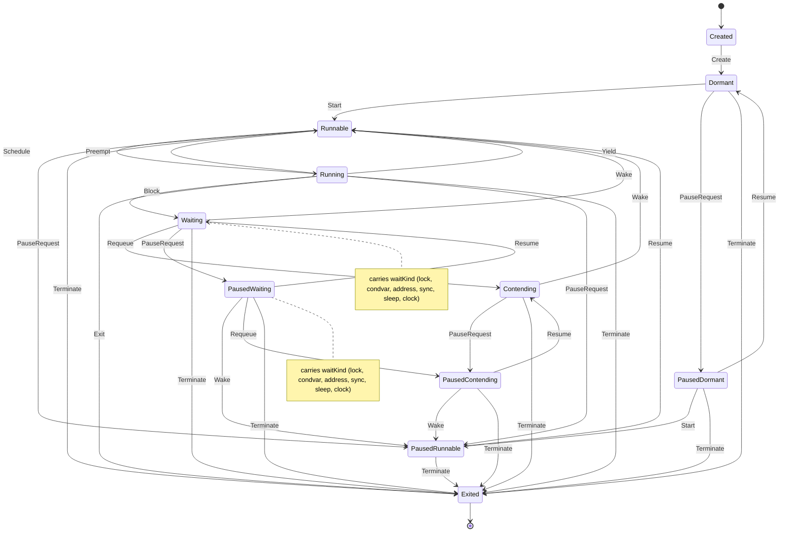

# kthread

<!-- GENERATED by `npm run kit:diagrams` from src/kit/defs/kthread.json. Do not edit. -->

Lifecycle of one guest thread in the kernel (src/kernel). Created is the slot while CreateThread fills it in; Dormant is a published thread before StartThread. A pause is a state: a thread that is waiting keeps its wait under it (PausedWaiting carries the same wait kind, PausedContending is a paused Contending), and it takes effect at a scheduling point: with green threads every thread but the caller of SetThreadActivity is at one, so a running thread of another core goes straight to PausedRunnable. Contending is a condition-variable waiter that was signalled while its mutex was held: it now waits for that lock. Terminate is process teardown and leaves every state but Created.

Machine id 9. Any (state, event) pair not listed below is refused: the state stays, `step` returns false and a `[RED] ` line is logged.

| # | State | Carries |
|---|---|---|
| 0 | Created (initial) |  |
| 1 | Dormant |  |
| 2 | Runnable |  |
| 3 | Running |  |
| 4 | Waiting | waitKind: 1 lock, 2 condvar, 3 address, 4 sync, 5 sleep, 6 clock |
| 5 | Contending |  |
| 6 | PausedDormant |  |
| 7 | PausedRunnable |  |
| 8 | PausedWaiting | waitKind: 1 lock, 2 condvar, 3 address, 4 sync, 5 sleep, 6 clock |
| 9 | PausedContending |  |
| 10 | Exited (final) |  |

| From | Event (#) | To |
|---|---|---|
| Created | Create (0) | Dormant |
| Dormant | Start (1) | Runnable |
| Runnable | Schedule (2) | Running |
| Running | Preempt (3) | Runnable |
| Running | Yield (4) | Runnable |
| Running | Block (5) | Waiting |
| Running | Exit (10) | Exited |
| Waiting | Wake (7) | Runnable |
| Waiting | Requeue (6) | Contending |
| Contending | Wake (7) | Runnable |
| Dormant | PauseRequest (8) | PausedDormant |
| Runnable | PauseRequest (8) | PausedRunnable |
| Running | PauseRequest (8) | PausedRunnable |
| Waiting | PauseRequest (8) | PausedWaiting |
| Contending | PauseRequest (8) | PausedContending |
| PausedDormant | Start (1) | PausedRunnable |
| PausedDormant | Resume (9) | Dormant |
| PausedRunnable | Resume (9) | Runnable |
| PausedWaiting | Resume (9) | Waiting |
| PausedWaiting | Wake (7) | PausedRunnable |
| PausedWaiting | Requeue (6) | PausedContending |
| PausedContending | Wake (7) | PausedRunnable |
| PausedContending | Resume (9) | Contending |
| Dormant | Terminate (11) | Exited |
| Runnable | Terminate (11) | Exited |
| Running | Terminate (11) | Exited |
| Waiting | Terminate (11) | Exited |
| Contending | Terminate (11) | Exited |
| PausedDormant | Terminate (11) | Exited |
| PausedRunnable | Terminate (11) | Exited |
| PausedWaiting | Terminate (11) | Exited |
| PausedContending | Terminate (11) | Exited |
