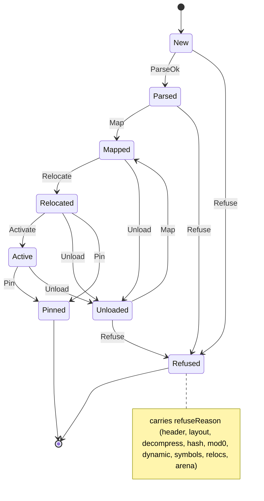

# module

<!-- GENERATED by `npm run kit:diagrams` from src/kit/defs/module.json. Do not edit. -->

Lifecycle of a guest code module (NSO or NRO) in src/loader/module.ts. A module record always refers to the file bytes it was parsed from, in every state except the two final ones: mapping (the first time or again after an unload) decompresses the segments from those bytes and zeroes the bss, so a reload cannot find its pristine copy missing. Pin is the only event that lets go of the file, and a pinned module can no longer be unloaded. A module of the process's start set is pinned as soon as it is relocated, before its init functions run (the embedder takes the file's memory back before any guest code runs); a module loaded at run time goes through Active. Refused carries the reason; a refused module is never mapped or relocated.

Machine id 37. Any (state, event) pair not listed below is refused: the state stays, `step` returns false and a `[RED] ` line is logged.

| # | State | Carries |
|---|---|---|
| 0 | New (initial) |  |
| 1 | Parsed |  |
| 2 | Mapped |  |
| 3 | Relocated |  |
| 4 | Active |  |
| 5 | Pinned (final) |  |
| 6 | Unloaded |  |
| 7 | Refused (final) | refuseReason: 1 header, 2 layout, 3 decompress, 4 hash, 5 mod0, 6 dynamic, 7 symbols, 8 relocs, 9 arena |

| From | Event (#) | To |
|---|---|---|
| New | ParseOk (0) | Parsed |
| New | Refuse (6) | Refused |
| Parsed | Map (1) | Mapped |
| Parsed | Refuse (6) | Refused |
| Mapped | Relocate (2) | Relocated |
| Mapped | Unload (5) | Unloaded |
| Relocated | Activate (3) | Active |
| Relocated | Unload (5) | Unloaded |
| Relocated | Pin (4) | Pinned |
| Active | Pin (4) | Pinned |
| Active | Unload (5) | Unloaded |
| Unloaded | Map (1) | Mapped |
| Unloaded | Refuse (6) | Refused |
