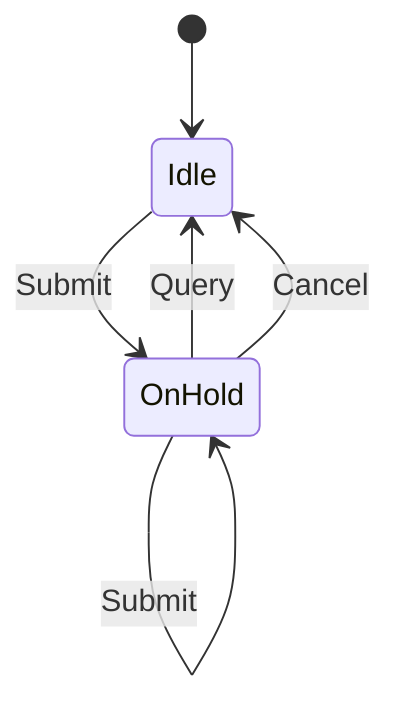

# nifm_request

<!-- GENERATED by `npm run kit:diagrams` from src/kit/defs/nifm_request.json. Do not edit. -->

The one nn::nifm network request of an offline console (port of nxnative hle_net.c g_nifm_hold): SubmitNetworkRequest puts it on hold, the first IsNetworkRequestOnHold after that still answers true and settles it (as unavailable), CancelNetworkRequest drops it. Idle is both "none" and "settled".

Machine id 28. Any (state, event) pair not listed below is refused: the state stays, `step` returns false and a `[RED] ` line is logged.

| # | State | Carries |
|---|---|---|
| 0 | Idle (initial) |  |
| 1 | OnHold |  |

| From | Event (#) | To |
|---|---|---|
| Idle | Submit (0) | OnHold |
| OnHold | Submit (0) | OnHold |
| OnHold | Query (1) | Idle |
| OnHold | Cancel (2) | Idle |
