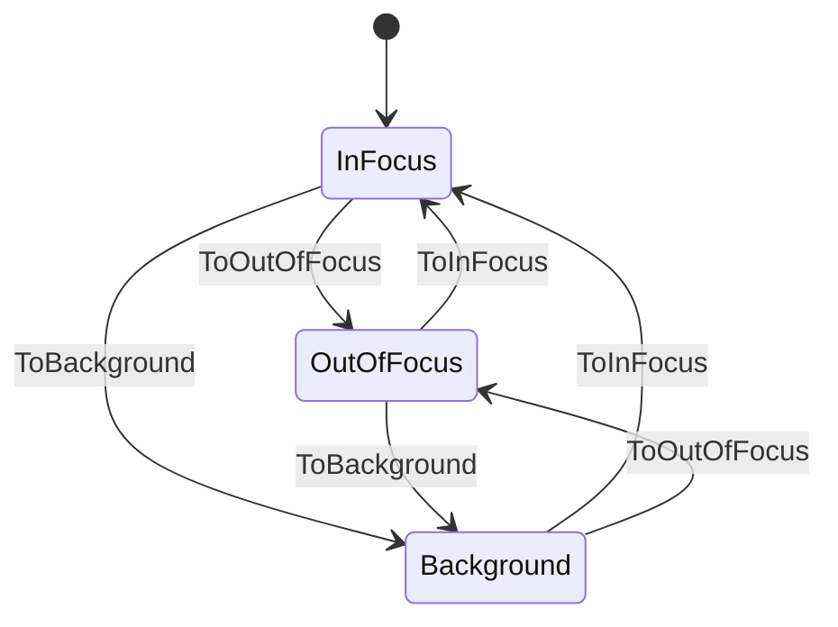

# oe_focus

<!-- GENERATED by `npm run kit:diagrams` from src/kit/defs/oe_focus.json. Do not edit. -->

nn::oe focus state (port of nxnative dm/host/hle_oe.c: g_focus and g_seen). Two instances: #0 is what the front end reported (dm_focus_set), #1 is what the game sees (GetCurrentFocusState), which is OutOfFocus while a library applet is open over a front end that is InFocus. The state's number + 1 is the SDK's FocusState (1 InFocus, 2 OutOfFocus, 3 Background). A change of instance #1 is one notification 15 when the game's focus handling mode asks for them. The guard is focusSync in src/hle/oe.ts.

Machine id 24. Any (state, event) pair not listed below is refused: the state stays, `step` returns false and a `[RED] ` line is logged.

| # | State | Carries |
|---|---|---|
| 0 | InFocus (initial) |  |
| 1 | OutOfFocus |  |
| 2 | Background |  |

| From | Event (#) | To |
|---|---|---|
| InFocus | ToOutOfFocus (1) | OutOfFocus |
| InFocus | ToBackground (2) | Background |
| OutOfFocus | ToInFocus (0) | InFocus |
| OutOfFocus | ToBackground (2) | Background |
| Background | ToInFocus (0) | InFocus |
| Background | ToOutOfFocus (1) | OutOfFocus |
