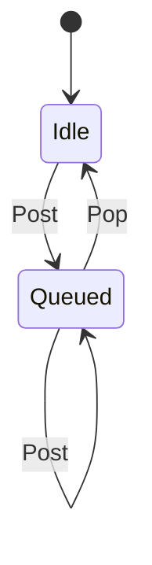

# oe_msg

<!-- GENERATED by `npm run kit:diagrams` from src/kit/defs/oe_msg.json. Do not edit. -->

One coalescing kind of nn::oe notification (port of nxnative hle_oe.c mq_push_). Three instances: 15 focus change, 30 operation mode change, 31 performance mode change. These only say "query the current state", so while one is queued and not yet popped a second Post keeps the first queue position and adds nothing. Other message numbers are per-occurrence and go to the ring without a machine.

Machine id 18. Any (state, event) pair not listed below is refused: the state stays, `step` returns false and a `[RED] ` line is logged.

| # | State | Carries |
|---|---|---|
| 0 | Idle (initial) |  |
| 1 | Queued |  |

| From | Event (#) | To |
|---|---|---|
| Idle | Post (0) | Queued |
| Queued | Post (0) | Queued |
| Queued | Pop (1) | Idle |
