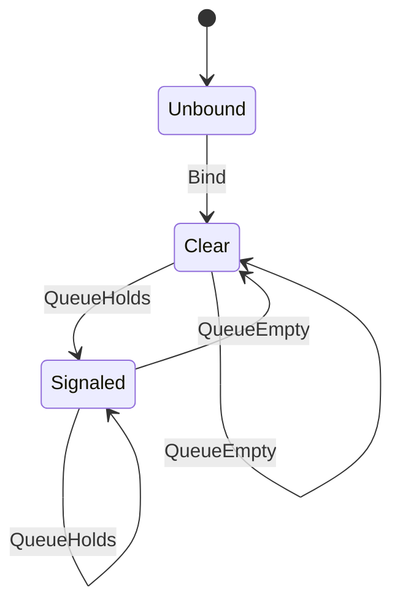

# oe_notify_event

<!-- GENERATED by `npm run kit:diagrams` from src/kit/defs/oe_notify_event.json. Do not edit. -->

The event nn::oe::GetNotificationMessageEvent hands out (port of nxnative hle_oe.c g_mq_ev / mq_ev_sync): bound once, on the first call, then it follows the queue as the am service's does: signalled while a notification is queued, cleared when the last one is popped (also a pop that found the queue empty clears a signal left behind). Before it is bound nothing is signalled.

Machine id 25. Any (state, event) pair not listed below is refused: the state stays, `step` returns false and a `[RED] ` line is logged.

| # | State | Carries |
|---|---|---|
| 0 | Unbound (initial) |  |
| 1 | Clear |  |
| 2 | Signaled |  |

| From | Event (#) | To |
|---|---|---|
| Unbound | Bind (0) | Clear |
| Clear | QueueHolds (1) | Signaled |
| Signaled | QueueHolds (1) | Signaled |
| Signaled | QueueEmpty (2) | Clear |
| Clear | QueueEmpty (2) | Clear |
