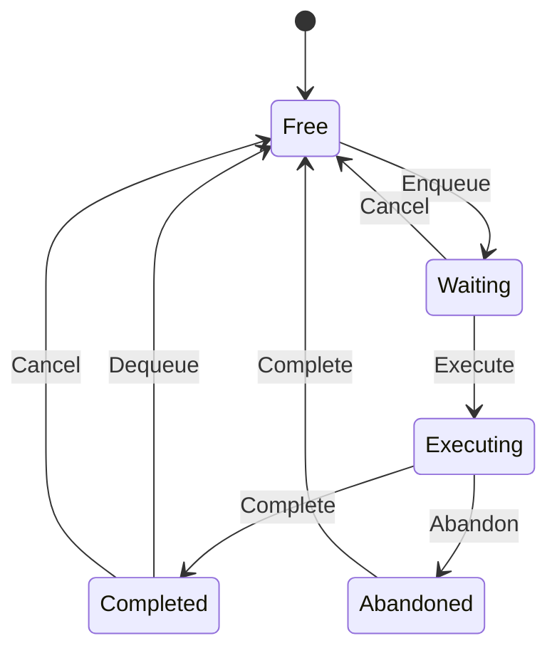

# opus_req

<!-- GENERATED by `npm run kit:diagrams` from src/kit/defs/opus_req.json. Do not edit. -->

One decode request of a hardware Opus decoder manager (src/audio/opus.ts), which is also one of the manager's I/O buffers. Waiting: the packet is queued (EnqueueOpusDataToHardwareOpusDecoder). Executing: ExecuteHardwareOpusDecoderDecoding handed it to the decoder; a synchronous decoder completes it inside that call, an asynchronous one (WebCodecs) later. Completed: its PCM waits for DequeuePcmInterleavedData. Cancel is a reset or finalize of its decoder; a request the asynchronous decoder still holds becomes Abandoned and its slot is free again only when the decoder answers, so a late answer can never land in a reused slot.

Machine id 4. Any (state, event) pair not listed below is refused: the state stays, `step` returns false and a `[RED] ` line is logged.

| # | State | Carries |
|---|---|---|
| 0 | Free (initial) |  |
| 1 | Waiting |  |
| 2 | Executing |  |
| 3 | Completed |  |
| 4 | Abandoned |  |

| From | Event (#) | To |
|---|---|---|
| Free | Enqueue (0) | Waiting |
| Waiting | Execute (1) | Executing |
| Executing | Complete (2) | Completed |
| Completed | Dequeue (3) | Free |
| Waiting | Cancel (4) | Free |
| Completed | Cancel (4) | Free |
| Executing | Abandon (5) | Abandoned |
| Abandoned | Complete (2) | Free |
