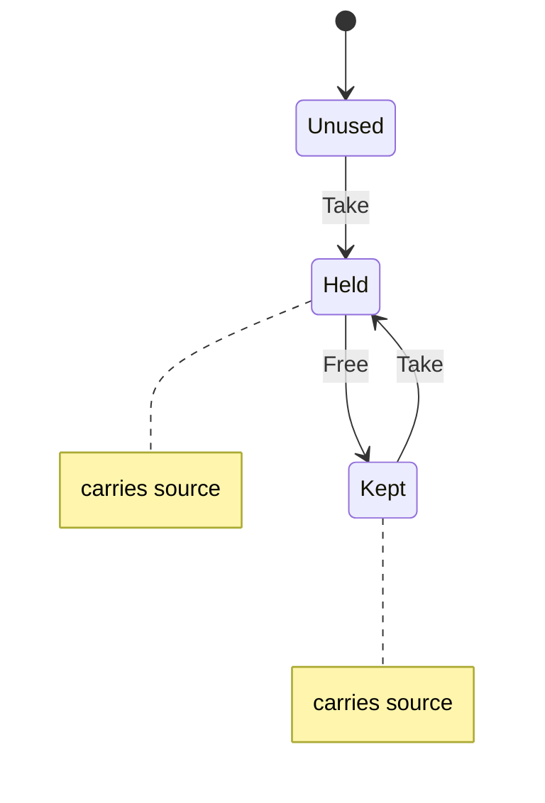

# pad_slot

<!-- GENERATED by `npm run kit:diagrams` from src/kit/defs/pad_slot.json. Do not edit. -->

One of the eight player slots of the input sources (port of nxnative dm/host/pad_slots.h; src/hle/padslots.ts). Unused: no source has held it. Held: a connected source holds it and is that player. Kept: its source went away; the slot is free, and that source gets it back before any other takes it (another source takes a Kept slot only when it is player 1's or no Unused slot is left). nxnative knows the source that left by its name string; here it is the embedder's stable source id, which both states carry.

Machine id 27. Any (state, event) pair not listed below is refused: the state stays, `step` returns false and a `[RED] ` line is logged.

| # | State | Carries |
|---|---|---|
| 0 | Unused (initial) |  |
| 1 | Held | source: the embedder's stable id of the source that holds the slot |
| 2 | Kept | source: the embedder's stable id of the source that left |

| From | Event (#) | To |
|---|---|---|
| Unused | Take (0) | Held |
| Held | Free (1) | Kept |
| Kept | Take (0) | Held |
