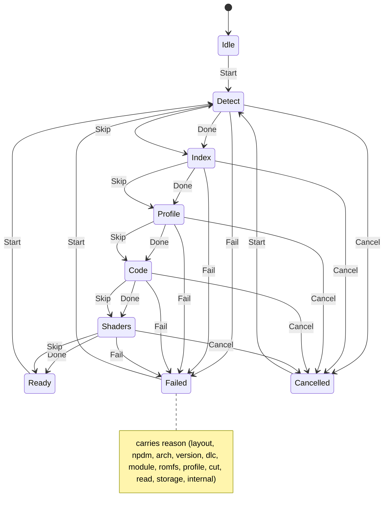

# prepare

<!-- GENERATED by `npm run kit:diagrams` from src/kit/defs/prepare.json. Do not edit. -->

The prepare step: a folder of the player's own game files becomes what the runtime starts (code modules with their cuts applied, a RomFS device over the folder, the game's profile). One instance per prepare run. The five stages run in order; each ends with Done (it did its work) or Skip (the manifest holds its output for the same input hash). Fail and Cancel leave any stage; Start from Idle, or again from Ready, Failed or Cancelled (a resume: the stages already done are skipped by their hashes, and a stage to redo has had its manifest record removed). Failed carries the reason. Progress is this state plus the counters of the module (prep_count), never text.

Machine id 38. Any (state, event) pair not listed below is refused: the state stays, `step` returns false and a `[RED] ` line is logged.

| # | State | Carries |
|---|---|---|
| 0 | Idle (initial) |  |
| 1 | Detect |  |
| 2 | Index |  |
| 3 | Profile |  |
| 4 | Code |  |
| 5 | Shaders |  |
| 6 | Ready |  |
| 7 | Failed | reason: 1 layout, 2 npdm, 3 arch, 4 version, 5 dlc, 6 module, 7 romfs, 8 profile, 9 cut, 10 read, 11 storage, 12 internal |
| 8 | Cancelled |  |

| From | Event (#) | To |
|---|---|---|
| Idle | Start (0) | Detect |
| Ready | Start (0) | Detect |
| Failed | Start (0) | Detect |
| Cancelled | Start (0) | Detect |
| Detect | Done (1) | Index |
| Detect | Skip (2) | Index |
| Index | Done (1) | Profile |
| Index | Skip (2) | Profile |
| Profile | Done (1) | Code |
| Profile | Skip (2) | Code |
| Code | Done (1) | Shaders |
| Code | Skip (2) | Shaders |
| Shaders | Done (1) | Ready |
| Shaders | Skip (2) | Ready |
| Detect | Fail (3) | Failed |
| Index | Fail (3) | Failed |
| Profile | Fail (3) | Failed |
| Code | Fail (3) | Failed |
| Shaders | Fail (3) | Failed |
| Detect | Cancel (4) | Cancelled |
| Index | Cancel (4) | Cancelled |
| Profile | Cancel (4) | Cancelled |
| Code | Cancel (4) | Cancelled |
| Shaders | Cancel (4) | Cancelled |
