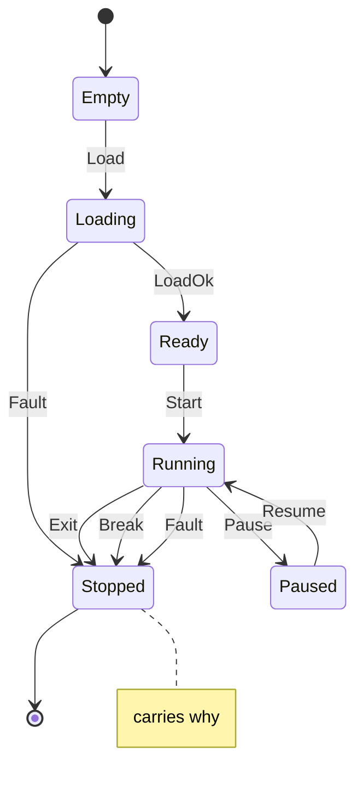

# process

<!-- GENERATED by `npm run kit:diagrams` from src/kit/defs/process.json. Do not edit. -->

Lifecycle of the one guest process a runtime holds (src/runtime). Empty: nothing loaded. Loading: files are being parsed, mapped and relocated. Ready: the main thread exists and has not run. Running: the run loop gives guest threads their slices. Paused: the run loop returned at a slice boundary and every thread keeps its saved context. Stopped is final and carries why: bits 32..39 the kind (1 exit, 2 break, 3 fault) and bits 0..31 the exit code (exit, break) or the fault kind (fault; src/runtime/index.ts FAULT_*). A file the loader refuses stops the process from Loading with a fault.

Machine id 18. Any (state, event) pair not listed below is refused: the state stays, `step` returns false and a `[RED] ` line is logged.

| # | State | Carries |
|---|---|---|
| 0 | Empty (initial) |  |
| 1 | Loading |  |
| 2 | Ready |  |
| 3 | Running |  |
| 4 | Paused |  |
| 5 | Stopped (final) | why: kind << 32 | exit code or fault kind |

| From | Event (#) | To |
|---|---|---|
| Empty | Load (0) | Loading |
| Loading | LoadOk (1) | Ready |
| Loading | Fault (7) | Stopped |
| Ready | Start (2) | Running |
| Running | Pause (3) | Paused |
| Paused | Resume (4) | Running |
| Running | Exit (5) | Stopped |
| Running | Break (6) | Stopped |
| Running | Fault (7) | Stopped |
