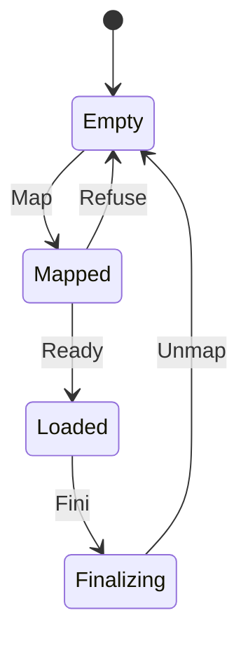

# ro_module

<!-- GENERATED by `npm run kit:diagrams` from src/kit/defs/ro_module.json. Do not edit. -->

One module loaded at run time through nn::ro (port of nxnative dm/host/hle_ro.c: module_t.loaded and nn::ro::Module.state; src/hle/ro.ts, 64 slots). Map: LoadModule had the embedder's loader map and relocate the image (import hle_ro_load); no code of it has run. Refuse: the image turned out to be an online SDK (it exports EOS_Platform_Create) and was unmapped again. Ready: nn::ro::Module.state is 1 from here; its init functions run next and the embedder then activates it (hle_ro_activate). Fini: UnloadModule runs its fini functions. Unmap: the loader took it out (hle_ro_unload). A slot is used again by the next load, so a module unloaded and loaded again goes round the same states.

Machine id 32. Any (state, event) pair not listed below is refused: the state stays, `step` returns false and a `[RED] ` line is logged.

| # | State | Carries |
|---|---|---|
| 0 | Empty (initial) |  |
| 1 | Mapped |  |
| 2 | Loaded |  |
| 3 | Finalizing |  |

| From | Event (#) | To |
|---|---|---|
| Empty | Map (0) | Mapped |
| Mapped | Refuse (1) | Empty |
| Mapped | Ready (2) | Loaded |
| Loaded | Fini (3) | Finalizing |
| Finalizing | Unmap (4) | Empty |
