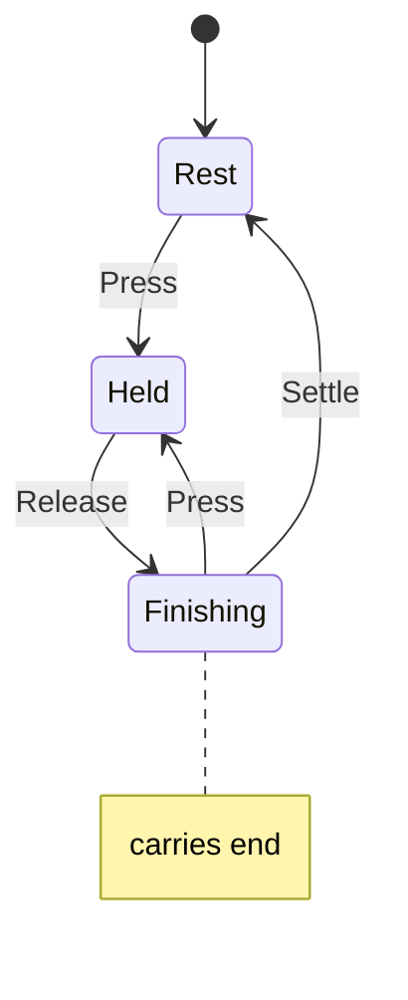

# six_shake

<!-- GENERATED by `npm run kit:diagrams` from src/kit/defs/six_shake.json. Do not edit. -->

Player 1's controller shaken by a button (port of nxnative dm/host/hle_hid.c: g_shake_on, g_shake_t0, g_shake_end; the embedder's shake bit, bit 63 of a snapshot's buttons). The six-axis sensor moves side to side in whole cycles of 1/6 s on the guest clock, so it always comes back to rest: Press starts a shake (from Finishing it continues the one still finishing), holding keeps shaking, Release lets the current cycle finish (a tap of one frame is still one whole shake), and Settle is offered by the guard once the guest clock has passed that cycle's end. Finishing carries the end time.

Machine id 29. Any (state, event) pair not listed below is refused: the state stays, `step` returns false and a `[RED] ` line is logged.

| # | State | Carries |
|---|---|---|
| 0 | Rest (initial) |  |
| 1 | Held |  |
| 2 | Finishing | end: guest ns at which the last cycle ends |

| From | Event (#) | To |
|---|---|---|
| Rest | Press (0) | Held |
| Held | Release (1) | Finishing |
| Finishing | Press (0) | Held |
| Finishing | Settle (2) | Rest |
