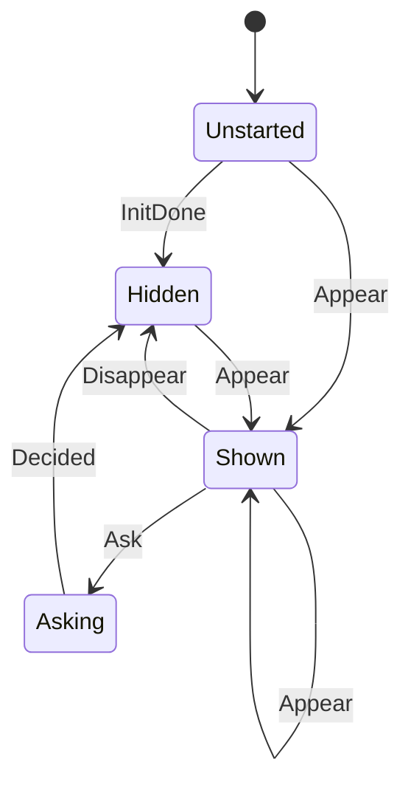

# swkbd_inline

<!-- GENERATED by `npm run kit:diagrams` from src/kit/defs/swkbd_inline.json. Do not edit. -->

One nn::swkbd::InlineKeyboard (port of nxnative hle_swkbd.c g_ikb[].state and .pending). Unstarted: Calc returns 0 until the Calc after Initialize. Hidden: Calc returns 1. Shown: Appear armed a request, Calc returns 3; the next Calc asks for the text. Asking: that Calc waits for the embedder's answer (nxnative blocks in the input box here); it then calls the game's callbacks and the keyboard is Hidden.

Machine id 23. Any (state, event) pair not listed below is refused: the state stays, `step` returns false and a `[RED] ` line is logged.

| # | State | Carries |
|---|---|---|
| 0 | Unstarted (initial) |  |
| 1 | Hidden |  |
| 2 | Shown |  |
| 3 | Asking |  |

| From | Event (#) | To |
|---|---|---|
| Unstarted | InitDone (0) | Hidden |
| Unstarted | Appear (1) | Shown |
| Hidden | Appear (1) | Shown |
| Shown | Appear (1) | Shown |
| Shown | Disappear (2) | Hidden |
| Shown | Ask (3) | Asking |
| Asking | Decided (4) | Hidden |
