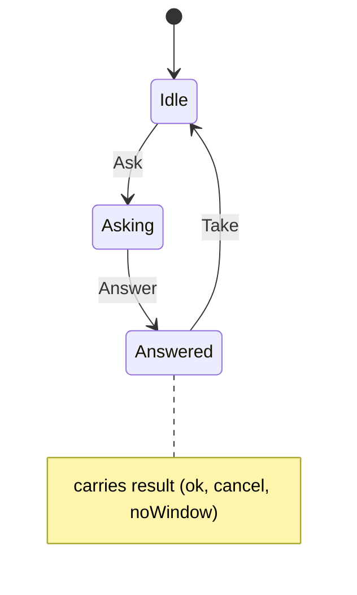

# swkbd_request

<!-- GENERATED by `npm run kit:diagrams` from src/kit/defs/swkbd_request.json. Do not edit. -->

One request for text to the embedder's input box (what nxnative's front_text_input blocks in, hle_swkbd.c). Ask: the import hle_text_request was called. Answer: the embedder called hle_text_answer (inside the import or any time later) with 1 OK, 2 cancel or 3 no window. Take: the take-over that asked read the answer. One request at a time, as one applet.

Machine id 31. Any (state, event) pair not listed below is refused: the state stays, `step` returns false and a `[RED] ` line is logged.

| # | State | Carries |
|---|---|---|
| 0 | Idle (initial) |  |
| 1 | Asking |  |
| 2 | Answered | result: 1 ok, 2 cancel, 3 noWindow |

| From | Event (#) | To |
|---|---|---|
| Idle | Ask (0) | Asking |
| Asking | Answer (1) | Answered |
| Answered | Take (2) | Idle |
