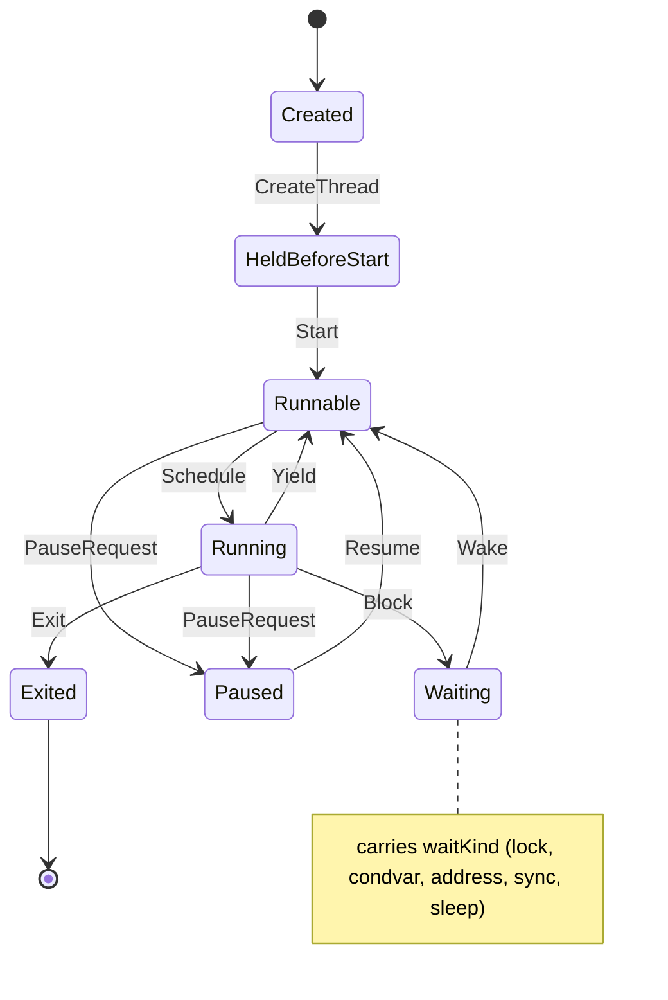

# thread

<!-- GENERATED by `npm run kit:diagrams` from src/kit/defs/thread.json. Do not edit. -->

Lifecycle of one guest thread. Only the machine: no scheduler decides here which thread gets Schedule. Created is the slot before CreateThread has published the thread; HeldBeforeStart is a published thread waiting for StartThread.

Machine id 2. Any (state, event) pair not listed below is refused: the state stays, `step` returns false and a `[RED] ` line is logged.

| # | State | Carries |
|---|---|---|
| 0 | Created (initial) |  |
| 1 | HeldBeforeStart |  |
| 2 | Runnable |  |
| 3 | Running |  |
| 4 | Waiting | waitKind: 1 lock, 2 condvar, 3 address, 4 sync, 5 sleep |
| 5 | Paused |  |
| 6 | Exited (final) |  |

| From | Event (#) | To |
|---|---|---|
| Created | CreateThread (0) | HeldBeforeStart |
| HeldBeforeStart | Start (1) | Runnable |
| Runnable | Schedule (4) | Running |
| Running | Yield (5) | Runnable |
| Running | Block (6) | Waiting |
| Waiting | Wake (7) | Runnable |
| Runnable | PauseRequest (2) | Paused |
| Running | PauseRequest (2) | Paused |
| Paused | Resume (3) | Runnable |
| Running | Exit (8) | Exited |
