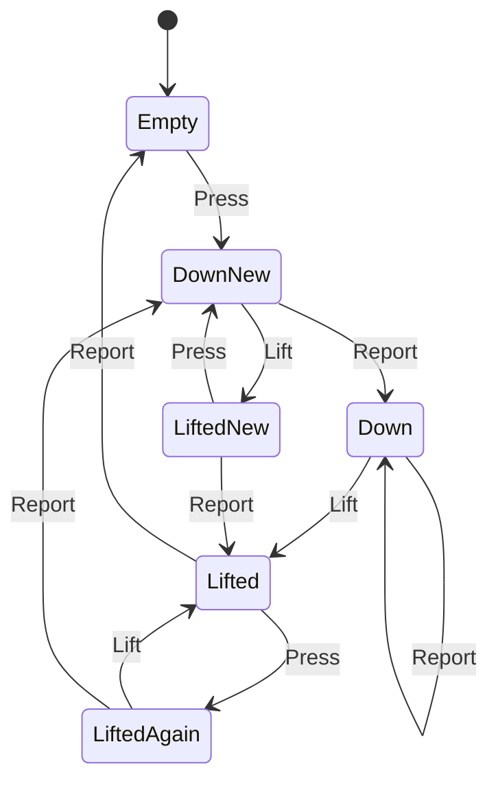

# touch_finger

<!-- GENERATED by `npm run kit:diagrams` from src/kit/defs/touch_finger.json. Do not edit. -->

One finger id of the touch screen as the game's reads see it (port of nxnative dm/host/hle_touch.c: g_f[].st, .reported, .again; src/hle/touch.ts). The game looks only at the newest state, so a finger is reported once with Start and, after it lifted, once more with End before it goes: a press and lift between two reads is Start at one read and End at the next. Press and Lift come from the embedder's touch points, Report from a read by the game (GetTouchScreenState). DownNew: down, Start not yet reported. Down: down, reported. LiftedNew: lifted before Start was reported (the next read reports Start, the one after End). Lifted: End is due. LiftedAgain: pressed again before End went out (the next read reports End at the old point, then the new press starts).

Machine id 32. Any (state, event) pair not listed below is refused: the state stays, `step` returns false and a `[RED] ` line is logged.

| # | State | Carries |
|---|---|---|
| 0 | Empty (initial) |  |
| 1 | DownNew |  |
| 2 | Down |  |
| 3 | LiftedNew |  |
| 4 | Lifted |  |
| 5 | LiftedAgain |  |

| From | Event (#) | To |
|---|---|---|
| Empty | Press (0) | DownNew |
| DownNew | Lift (1) | LiftedNew |
| DownNew | Report (2) | Down |
| Down | Lift (1) | Lifted |
| Down | Report (2) | Down |
| LiftedNew | Press (0) | DownNew |
| LiftedNew | Report (2) | Lifted |
| Lifted | Press (0) | LiftedAgain |
| Lifted | Report (2) | Empty |
| LiftedAgain | Lift (1) | Lifted |
| LiftedAgain | Report (2) | DownNew |
