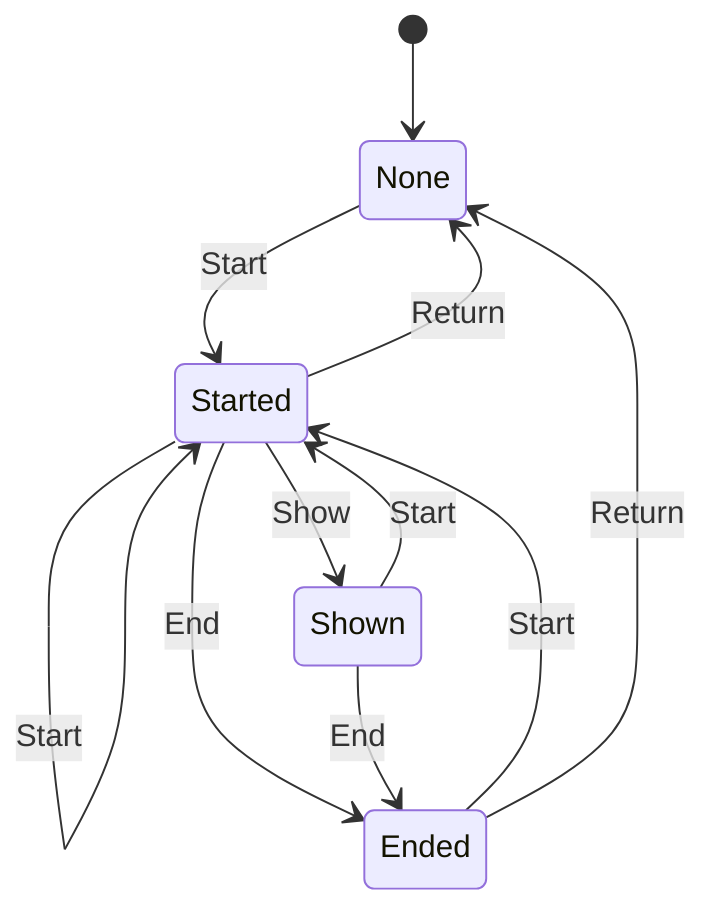

# web_session

<!-- GENERATED by `npm run kit:diagrams` from src/kit/defs/web_session.json. Do not edit. -->

The one offline HTML page of nn::web (port of nxnative hle_web.c g_web_state: 0 none, 1 started, 2 shown, 3 ended). Start replaces whatever was there. Ended: the exit event is signalled and WaitForExit takes the result (Return). Return from Started is the synchronous form giving up when no page could be shown.

Machine id 32. Any (state, event) pair not listed below is refused: the state stays, `step` returns false and a `[RED] ` line is logged.

| # | State | Carries |
|---|---|---|
| 0 | None (initial) |  |
| 1 | Started |  |
| 2 | Shown |  |
| 3 | Ended |  |

| From | Event (#) | To |
|---|---|---|
| None | Start (0) | Started |
| Started | Start (0) | Started |
| Shown | Start (0) | Started |
| Ended | Start (0) | Started |
| Started | Show (1) | Shown |
| Started | End (2) | Ended |
| Shown | End (2) | Ended |
| Ended | Return (3) | None |
| Started | Return (3) | None |
